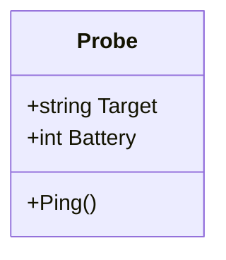

# Classes and objects: blueprints and ships

Up to now, a "ship" has been a handful of loose variables: `shipName`, `shipFuel`, `shipCrew`. With a fleet of twenty, that falls apart fast. **Object-oriented programming (OOP)** bundles the data and the behaviour that belong together into one unit.

## Class = blueprint, object = the real thing

A **class** describes what something *has* and what it can *do*. An **object** is one actual thing built from that class. You can build as many objects from one class as you like.

```csharp
class Probe
{
    // Fields: what every probe HAS
    public string Target;
    public int Battery;

    // Methods: what every probe can DO
    public void Ping()
    {
        Battery -= 5;
        Console.WriteLine($"Ping from {Target}. Battery: {Battery}");
    }
}
```



## Building and using objects

```csharp
Probe alpha = new Probe();     // build an object from the blueprint
alpha.Target = "Europa";
alpha.Battery = 50;

Probe beta = new Probe();      // a second, completely separate probe
beta.Target = "Io";
beta.Battery = 80;

alpha.Ping();   // Ping from Europa. Battery: 45
beta.Ping();    // Ping from Io. Battery: 75
```

- `new Probe()` creates an object.
- The **dot** `.` reaches into an object: `alpha.Target`, `alpha.Ping()`.
- **Each object has its own copy of the fields.** Changing `alpha.Battery` doesn't touch `beta`.
- Inside a method, `Battery` means "the battery of **whichever object this method was called on**".

## Setting fields as you build: object initialisers

You can set fields in the same statement that creates the object:

```csharp
Probe gamma = new Probe { Target = "Titan", Battery = 60 };
```

## Objects in collections

A class is a type like any other, so you can make a `List<Probe>` and loop over it:

```csharp
List<Probe> swarm = new List<Probe> { alpha, beta, gamma };
foreach (Probe p in swarm) p.Ping();
```

> **Pilot's tip:** when an object's value looks wrong, ask **which object** each line is working on. Calling the right method on the wrong object is a very easy mistake to make.

---

### Before you move on

- [ ] I can explain the difference between a class and an object
- [ ] I know `new` creates an object and the dot reaches its fields and methods
- [ ] I know every object has its own copy of the fields
- [ ] I can read an object initialiser such as `new Probe { Target = "Titan" }`
