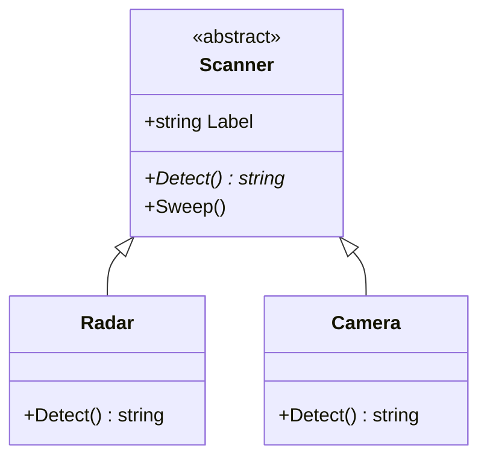

# Pillar 4: Abstraction

Some classes describe an idea that's too general to exist on its own. There's no such thing as just "a sensor". There are thermometers, radar and cameras. **Abstraction** lets you define **what** every kind of sensor must be able to do, while leaving **how** to each specific one.

## Abstract classes

Marking a class `abstract` makes it an **unfinished blueprint**: you can't create it with `new`, only inherit from it.

```csharp
abstract class Scanner
{
    public string Label;

    public Scanner(string label)
    {
        Label = label;
    }

    // WHAT every scanner must do: no body, just the promise
    public abstract string Detect();

    // Shared behaviour, written once, that relies on the promise
    public void Sweep()
    {
        Console.WriteLine($"[{Label}] {Detect()}");
    }
}

class Radar : Scanner
{
    public Radar() : base("Radar") { }
    public override string Detect() { return "3 contacts bearing north"; }
}

class Camera : Scanner
{
    public Camera() : base("Camera") { }
    public override string Detect() { return "visual on a derelict"; }
}
```

```csharp
Scanner[] array = { new Radar(), new Camera() };
foreach (Scanner s in array) s.Sweep();
// [Radar] 3 contacts bearing north
// [Camera] visual on a derelict

// Scanner generic = new Scanner("?");   // won't compile: Scanner is abstract
```



## Abstract members

- An `abstract` method or property has **no body**, just a semicolon.
- Every non-abstract class that inherits it **must** `override` it, or the code **won't compile**.
- `Sweep()` is an ordinary method. It calls `Detect()` without knowing or caring which scanner it's talking to.

Abstract **properties** work the same way:

```csharp
abstract class Cargo
{
    public abstract double Weight { get; }
}

class OreCrate : Cargo
{
    public override double Weight => 120.5;   // => returns the value
}
```

## `abstract` vs `virtual`

| | `virtual` | `abstract` |
| --- | --- | --- |
| Has a body? | Yes: a default version | No |
| Must derived classes override it? | No: the default is used if they don't | **Yes**: the compiler enforces it |
| Allowed in | Any class | Only abstract classes |

Use `abstract` when **there's no sensible default** and every subclass must decide for itself. A made-up default (say, returning 0) lets a forgotten override slip through without any warning.

---

### Before you move on

- [ ] I know an abstract class can't be created with `new`, only inherited from
- [ ] I know an abstract member has no body and must be overridden
- [ ] I know shared methods in an abstract class can rely on abstract members
- [ ] I can explain when to choose `abstract` over `virtual`
