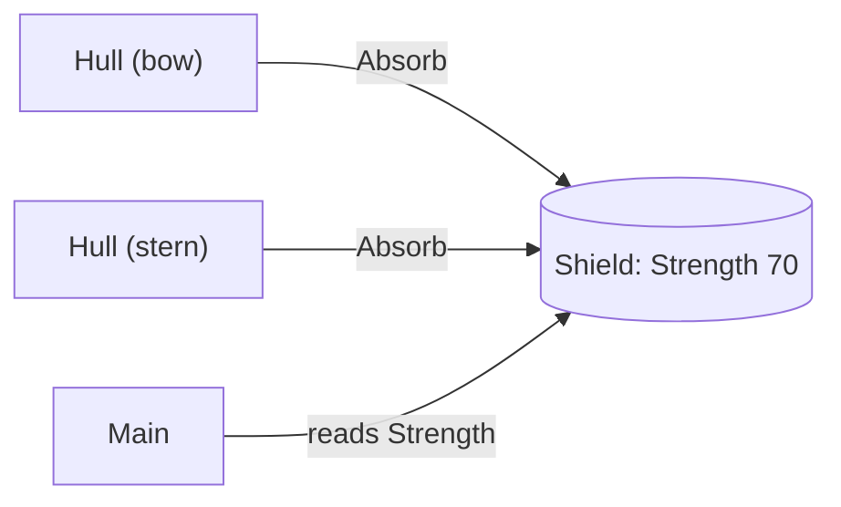

# Script communication 1: objects talking to objects

Real programs, and game projects where each script is a class, aren't one big object. They're many small objects that **cooperate**. To cooperate, an object needs a way to reach the others. That means holding a **reference** to them and **calling their methods**.

## Holding a reference

An object can keep another object in a field, and call its methods whenever it needs to:

```csharp
class Shield
{
    public int Strength = 100;
    public void Absorb(int hit) { Strength -= hit; }
}

class Hull
{
    private Shield shield;            // a reference to another object

    public Hull(Shield shield)
    {
        this.shield = shield;         // handed over when the hull is built
    }

    public void TakeHit(int damage)
    {
        shield.Absorb(damage);        // talking to the other object
    }
}
```

## Passing references in: sharing one object

Because classes are reference types, **passing the same object** to several others means they all share it:

```csharp
Shield shared = new Shield();
Hull bow = new Hull(shared);
Hull stern = new Hull(shared);

bow.TakeHit(10);
stern.TakeHit(20);
Console.WriteLine(shared.Strength);   // 70: one shield, hit twice
```



If one of them is given its **own** `new Shield()` instead, it talks to a different object, and the others never hear about it.

## Composition: "has a"

Inheritance says a Fighter **is a** Ship. **Composition** says a Ship **has an** Engine, a Radio and a Crew, and it gets its work done by asking them:

```csharp
class Bridge
{
    private Sensors sensors = new Sensors();
    private Helm helm = new Helm();

    public void AvoidCollision()
    {
        int bearing = sensors.ClosestThreat();   // ask one part for information
        helm.SteerAwayFrom(bearing);             // tell another part to act
    }
}
```

Code outside only talks to the `Bridge`. It doesn't need to know the sensors or the helm exist, which is encapsulation working alongside composition. Building objects out of smaller objects is often more flexible than deep inheritance chains.

## Who creates whom?

| Approach | Example | When to use it |
| --- | --- | --- |
| The object creates its parts | `private Radio radio = new Radio();` | The part belongs only to this object |
| The parts are passed in | `new Hull(shared)` | Several objects must share the same part |

> **Pilot's tip:** when two objects should be in sync but aren't, check whether they're really talking to **the same object**, or to two separate ones that just look alike.

---

### Before you move on

- [ ] I know objects communicate by holding references and calling each other's methods
- [ ] I know passing one object to several others makes them share it
- [ ] I can explain composition ("has a") versus inheritance ("is a")
- [ ] I know when a part should be created inside an object and when it should be passed in
