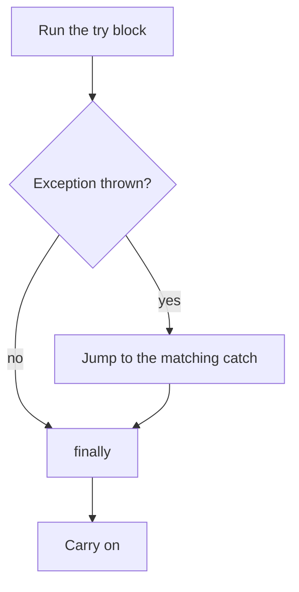

# Exceptions: when things go wrong

Some problems only show up while a program is running: text that isn't a number, a division by zero, a file that isn't there. When that happens, C# **throws an exception**. If nothing **catches** it, the program stops.

## Common exceptions

| Exception | Typical cause |
| --- | --- |
| `FormatException` | `int.Parse("abc")`: the text isn't a number |
| `DivideByZeroException` | Dividing an `int` by 0 |
| `IndexOutOfRangeException` | Using an array index that doesn't exist |
| `NullReferenceException` | Using something that is `null` |
| `ArgumentException` | A method was given a value it can't accept |

## `try`, `catch`, `finally`

```csharp
try
{
    int crew = int.Parse(input);
    Console.WriteLine($"Crew: {crew}");
}
catch (FormatException)
{
    Console.WriteLine("That isn't a number, Pilot");
}
finally
{
    Console.WriteLine("Input check done");
}
```



- As soon as something throws, the rest of the `try` block is **skipped**.
- C# runs the **first `catch` whose type matches** the exception. You can have several.
- `catch (FormatException error)` gives you the exception object, and `error.Message` describes what went wrong.
- `finally` runs **every time**, whether an exception happened or not. It's useful for clean-up.

## Throwing your own

A method can refuse a bad value by throwing:

```csharp
static void SetSpeed(int speed)
{
    if (speed > 9) throw new ArgumentException("Warp 9 is the limit");
    // ...
}
```

## Avoiding the exception: `TryParse`

For user input, it's usually better not to crash in the first place:

```csharp
if (int.TryParse(input, out int crew))
{
    Console.WriteLine($"Crew: {crew}");
}
else
{
    Console.WriteLine("That isn't a number, Pilot");
}
```

`TryParse` returns `true` or `false` instead of throwing, and hands the number back through the `out` variable.

> **Pilot's tip:** an empty `catch { }` hides the problem instead of handling it. If you catch something, **do something about it**: tell the user, log it, or use a safe fallback you've actually thought about.

---

### Before you move on

- [ ] I know the program stops if an exception isn't caught
- [ ] I can trace which `catch` runs, and know `finally` always runs
- [ ] I can throw an exception from a method
- [ ] I can use `int.TryParse` with `out`, and I know why an empty `catch` is dangerous
