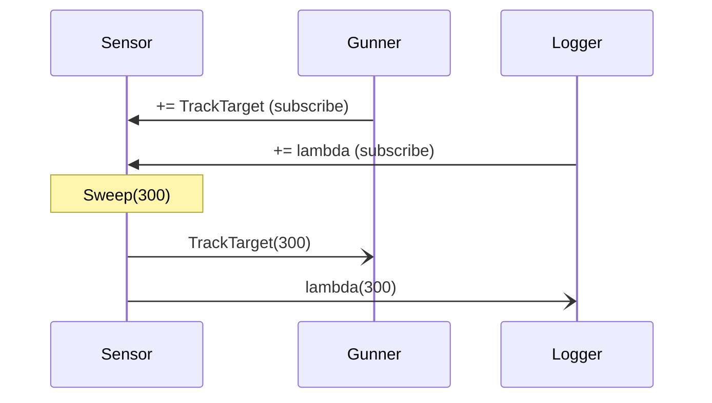

# Script communication 2: events

In the last quests, objects talked by holding a reference to each other: the hull **knows about** the shield. That works, but it ties them together. Sometimes an object should simply **announce** that something happened, without knowing or caring who's listening. That's an **event**, and it's how most games and apps let their scripts talk to each other.

## Publisher and subscribers

- The **publisher** owns the event and **raises** it when something happens.
- **Subscribers** attach their methods to the event, and every one of them is called when it's raised.

```csharp
class Sensor                                   // the publisher
{
    public event Action<int> ContactDetected;  // subscribers get an int (the distance)

    public void Sweep(int distance)
    {
        Console.WriteLine("Sweep complete");
        ContactDetected?.Invoke(distance);     // raise the event
    }
}

class Gunner                                   // a subscriber
{
    public void TrackTarget(int distance)
    {
        Console.WriteLine($"Gunner tracking at {distance} km");
    }
}
```

## Subscribing and unsubscribing

```csharp
Sensor sensor = new Sensor();
Gunner gunner = new Gunner();

sensor.ContactDetected += gunner.TrackTarget;                 // subscribe a method
sensor.ContactDetected += d => Console.WriteLine($"Log: {d}"); // or a lambda

sensor.Sweep(300);
// Sweep complete
// Gunner tracking at 300 km
// Log: 300

sensor.ContactDetected -= gunner.TrackTarget;                 // unsubscribe
```



Notice that `Sensor` never mentions `Gunner`. You can add a medic, a logger or a sound effect later **without changing the Sensor at all**. This is called **loose coupling**.

## The rules

| Rule | Why |
| --- | --- |
| `+=` adds a subscriber, `-=` removes one | Subscriptions build up: they're never replaced |
| Subscribers run in the order they subscribed | Each `+=` adds to the end of the list |
| Subscribing the same method twice means it runs **twice** | The event doesn't check for duplicates |
| Raise with `?.Invoke(...)` | With no subscribers, the event is `null`; `?.` safely does nothing |
| Outside code can only use `+=` and `-=` | The `event` keyword stops other classes from raising it or wiping its subscribers |

> **Pilot's tip:** a subscription lasts until it's removed. If a handler runs more times than you expect, look for a `+=` that has run more than once.

---

### Before you move on

- [ ] I can explain the publisher/subscriber idea, and why the publisher doesn't need to know its subscribers
- [ ] I can subscribe with `+=` and unsubscribe with `-=`
- [ ] I know what `?.Invoke` does when nobody has subscribed
- [ ] I know a duplicate subscription makes the handler run twice
