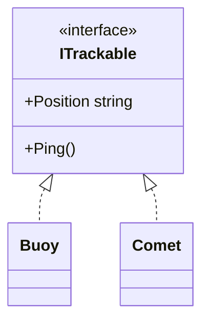

# Interfaces: what an object can do

Inheritance groups classes into families: a Fighter **is a** Ship. Some abilities cut across families, though. A shuttle, a cargo pod and an alien probe can all **dock**, but they share nothing else. An **interface** describes an ability that any class can sign up for.

## Declaring an interface

```csharp
interface ITrackable
{
    string Position { get; }
    void Ping();
}
```

An interface is a **contract**: a list of members with **no code**. By convention its name starts with `I`.

## Implementing it

A class promises to fulfil the contract by listing the interface after a colon, then providing every member:

```csharp
class Buoy : ITrackable
{
    public string Position => "Grid 4-7";
    public void Ping() { Console.WriteLine("Buoy: beep"); }
}

class Comet : ITrackable
{
    public string Position => "Outer ring";
    public void Ping() { Console.WriteLine("Comet: reflected signal"); }
}
```

If a class leaves anything out, it **won't compile**. And it isn't enough to happen to have the right methods: C# only treats a class as `ITrackable` if it **declares** it.

## Several at once

A class can inherit from only **one** base class, but it can implement **as many interfaces as it likes**:

```csharp
class Freighter : Ship, ITrackable, IRefuelable { ... }
```



## Coding to the interface

Variables and parameters can use an interface as their type. Then they accept **any** object that implements it:

```csharp
static void Track(ITrackable thing)
{
    Console.WriteLine($"Tracking at {thing.Position}");
    thing.Ping();
}

Track(new Buoy());
Track(new Comet());
```

Through an `ITrackable` variable you can **only** use what `ITrackable` promises. The rest of the object is still there, but that view of it can't see it.

## Checking with `is`

`object` is the base type of everything in C#, so it can hold any value. The `is` keyword checks whether an object implements an interface, and gives you a typed variable if it does:

```csharp
static void TryPing(object thing)
{
    if (thing is ITrackable t) t.Ping();
    else Console.WriteLine("Can't track that");
}
```

## Interfaces or abstract classes?

| Abstract class | Interface |
| --- | --- |
| A family: "is a" | An ability: "can do" |
| Can hold shared code and fields | Just the contract |
| Only one per class | As many as you like |

---

### Before you move on

- [ ] I know an interface is a contract of members with no code
- [ ] I know a class must declare the interface and provide every member
- [ ] I know a class can implement several interfaces but inherit from only one class
- [ ] I can use an interface as a parameter type, and `is` to check for one
