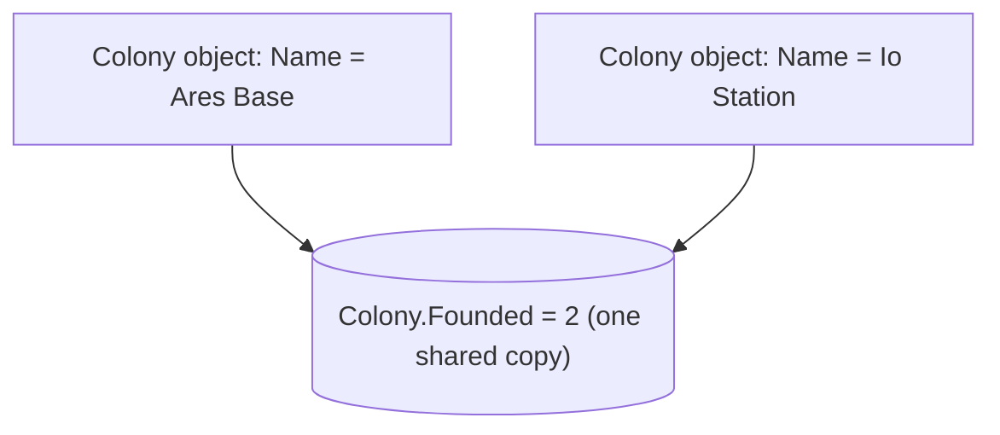

# Static: what belongs to the whole class

Everything on an object so far has belonged to **that one object**: each ship has its own name and fuel. Some things belong to the **class as a whole**: how many ships have been built, or a constant such as the speed of light. Those are marked `static`.

## Instance vs static

| | Instance member | Static member |
| --- | --- | --- |
| How many copies | One **per object** | **One**, shared by everything |
| Used through | An object: `ship.Name` | The class name: `Ship.Count` |
| Can see | Its own object's fields | Only other static members (there's no "this object") |

```csharp
class Colony
{
    public static int Founded = 0;   // one shared count
    public string Name;              // each colony has its own

    public Colony(string name)
    {
        Name = name;
        Founded++;                   // every new colony adds to the same count
    }
}

new Colony("Ares Base");
new Colony("Io Station");
Console.WriteLine(Colony.Founded);   // 2
```



## Static methods

A static method is called through the class, with no object needed. You've been writing them all along: `static void Main` is one.

```csharp
class Units
{
    public static double KmToMiles(double km)
    {
        return km * 0.621;
    }
}

double miles = Units.KmToMiles(100);   // 62.1
```

## Static classes and constants

A `static class` contains **only** static members and can never be created with `new`. It's a toolbox. C#'s own `Math` class works this way:

```csharp
Math.Max(4, 9);      // 9
Math.Min(4, 9);      // 4
Math.Abs(-7);        // 7
Math.Round(4.5);     // 4: it rounds to the nearest even number when exactly halfway
Math.Sqrt(16);       // 4
```

`const` declares a value that can never change, and is automatically shared by the class:

```csharp
public const int MaxCrew = 12;   // used as Colony.MaxCrew
```

> **Pilot's tip:** ask whether a value should be "one each" or "one for everyone". Making a per-object value `static` makes every object share it, so they all end up with the same number.

---

### Before you move on

- [ ] I know a static member has one shared copy and is used through the class name
- [ ] I know an instance member has one copy per object
- [ ] I can call static methods such as `Math.Max` without creating an object
- [ ] I know a static class can't be created with `new`
