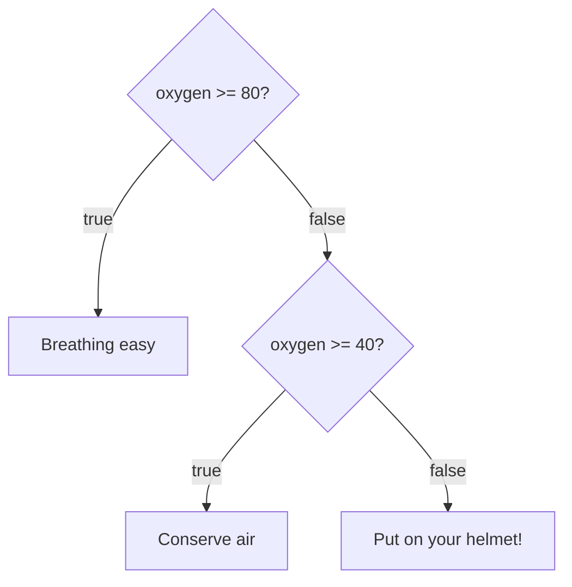

# Conditionals: making decisions

Programs need to react: raise the shields **if** an enemy appears, **otherwise** keep cruising. In C#, decisions are made with `if`, `else if` and `else`.

## Comparisons give a `bool`

A condition is anything that works out to `true` or `false`:

| Operator | Meaning | `7 ? 5` gives |
| --- | --- | --- |
| `==` | Equal to | `false` |
| `!=` | Not equal to | `true` |
| `>` | Greater than | `true` |
| `<` | Less than | `false` |
| `>=` | Greater than **or equal to** | `true` |
| `<=` | Less than **or equal to** | `false` |

Note that `==` **compares** two values, while a single `=` **stores** a value.

## `if`, `else if`, `else`

```csharp
int oxygen = 45;

if (oxygen >= 80)
{
    Console.WriteLine("Breathing easy");
}
else if (oxygen >= 40)
{
    Console.WriteLine("Conserve air");
}
else
{
    Console.WriteLine("Put on your helmet!");
}
```

C# checks the conditions **from the top down** and runs **only the first one that's true**. Then it skips the rest of the chain. The `else` at the end catches everything that didn't match.



With `oxygen` at 45, the first check is false and the second is true, so this prints `Conserve air`.

**The order matters.** If a broad check comes first, it catches values that a more specific check further down was meant to handle.

## Combining conditions

| Operator | Name | True when… |
| --- | --- | --- |
| `&&` | AND | **Both** sides are true |
| `\|\|` | OR | **At least one** side is true |
| `!` | NOT | Flips `true` to `false`, and `false` to `true` |

```csharp
bool hasKeycard = true;
bool alarmActive = false;

if (hasKeycard && !alarmActive)
{
    Console.WriteLine("Door opens");
}
```

This is `true && true`, so the door opens.

> **Pilot's tip:** check the edges. Does `> 30` include 30? (It doesn't, but `>= 30` does.)

---

### Before you move on

- [ ] I know the six comparison operators, and that `==` compares while `=` stores
- [ ] I know only the first true branch of an `if`/`else if` chain runs
- [ ] I know why the order of the checks matters
- [ ] I can work out `&&`, `||` and `!`
