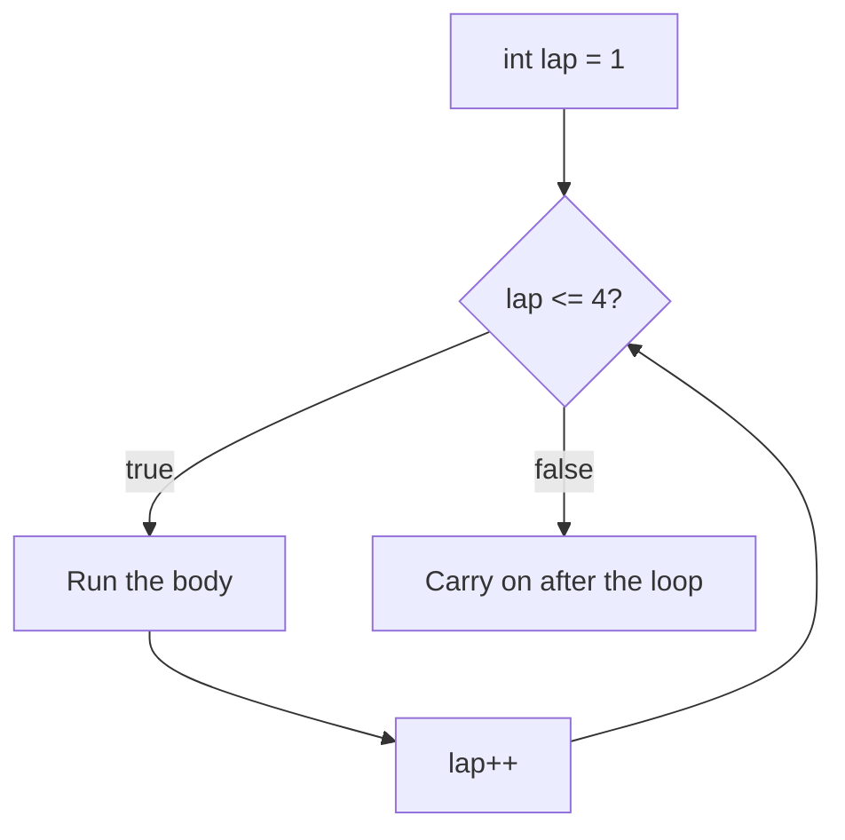

# Loops: doing it again (and again)

Scanning ten decks shouldn't take ten copies of the same code. A **loop** repeats a block for as long as you need.

## The `for` loop: when you know how many times

```csharp
for (int lap = 1; lap <= 4; lap++)
{
    Console.WriteLine($"Lap {lap}");
}
```

The brackets hold three parts, separated by semicolons:

| Part | Example | When it runs |
| --- | --- | --- |
| Start | `int lap = 1` | Once, before anything else |
| Condition | `lap <= 4` | Before **every** pass; when it's false, the loop ends |
| Step | `lap++` | After every pass |



This prints `Lap 1` to `Lap 4`, so the body runs 4 times.

## The `while` loop: until something changes

```csharp
int shields = 40;
while (shields < 100)
{
    shields += 25;
}
// shields is now 115
```

A `while` loop checks its condition before each pass. Something inside it **must** eventually make the condition false. Otherwise it loops forever.

## `break` and `continue`

| Keyword | What it does |
| --- | --- |
| `break` | Leaves the loop **immediately**. Nothing after it in the loop runs again |
| `continue` | Skips the rest of **this** pass and jumps to the next one |

```csharp
for (int deck = 1; deck <= 5; deck++)
{
    if (deck == 2) continue;    // skip deck 2
    if (deck == 4) break;       // stop completely at deck 4
    Console.WriteLine(deck);
}
```

This prints 1 and 3.

## A sneak peek: arrays

Loops are often used to visit every item in an **array**: a numbered list of values. You'll study arrays properly soon, but you'll need two facts now:

```csharp
int[] cells = { 30, 50, 20 };
Console.WriteLine(cells[0]);       // 30: positions start at 0
Console.WriteLine(cells.Length);   // 3: how many items there are
```

Because counting starts at 0, the **last** item is at `Length - 1`. So a loop over an array is written `for (int i = 0; i < cells.Length; i++)`: it uses `<`, not `<=`.

> **Pilot's tip:** to know how many times a loop runs, trace its counter through **every** pass until the condition fails.

---

### Before you move on

- [ ] I can name the three parts of a `for` loop and when each one runs
- [ ] I know a `while` loop needs something that eventually makes its condition false
- [ ] I know `break` leaves the loop and `continue` skips to the next pass
- [ ] I know array positions start at 0, so the last one is `Length - 1`
