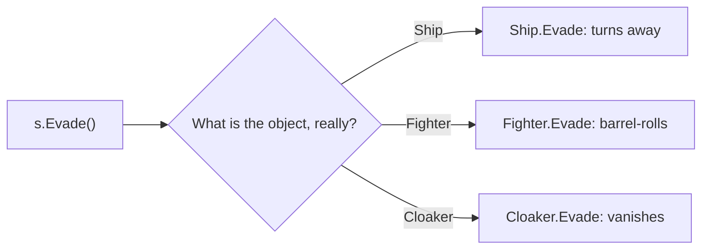

# Pillar 3: Polymorphism

Polymorphism means "many forms". You call **one method**, and each object responds **in its own way**. The fleet commander says "evade", and the fighter barrel-rolls, the freighter turns slowly and the cloaker vanishes, all from the same order.

## `virtual` and `override`

The base class marks a method `virtual` ("derived classes may replace this"). A derived class replaces it with `override`:

```csharp
class Ship
{
    public virtual string Evade()
    {
        return "turns away";
    }
}

class Fighter : Ship
{
    public override string Evade()
    {
        return "barrel-rolls";
    }
}

class Cloaker : Ship
{
    public override string Evade()
    {
        return "vanishes from sensors";
    }
}
```

## The object decides, not the variable

Here's the important part. Even when every ship is held in a `Ship` variable, C# runs the version that belongs to the **actual object**:

```csharp
List<Ship> fleet = new List<Ship> { new Ship(), new Fighter(), new Cloaker() };

foreach (Ship s in fleet)
{
    Console.WriteLine(s.Evade());
}
// turns away
// barrel-rolls
// vanishes from sensors
```



This is what makes polymorphism powerful: code that works with `Ship` **never needs changing** when you add a new kind of ship. Write one more class with its own override, and the existing loop handles it.

## Reusing the original with `base`

An override can call the base version and add to it:

```csharp
class Tanker : Ship
{
    public override string Evade()
    {
        return "dumps fuel and " + base.Evade();   // "dumps fuel and turns away"
    }
}
```

## Polymorphic parameters

Methods can take the base type and work with any derived object:

```csharp
static void Drill(Ship s)
{
    Console.WriteLine($"Drill: ship {s.Evade()}");
}

Drill(new Cloaker());   // Drill: ship vanishes from sensors
```

> **Pilot's tip:** to change behaviour in a derived class, the base method must be `virtual` **and** the new one must be marked `override`. Anything else gives you a separate method that calls through a base-type variable won't use.

---

### Before you move on

- [ ] I know `virtual` allows replacing and `override` replaces
- [ ] I know the actual object's version runs, even through a base-type variable
- [ ] I can use `base.Method()` to build on the original
- [ ] I can explain why a list of base-type objects can behave differently per item
