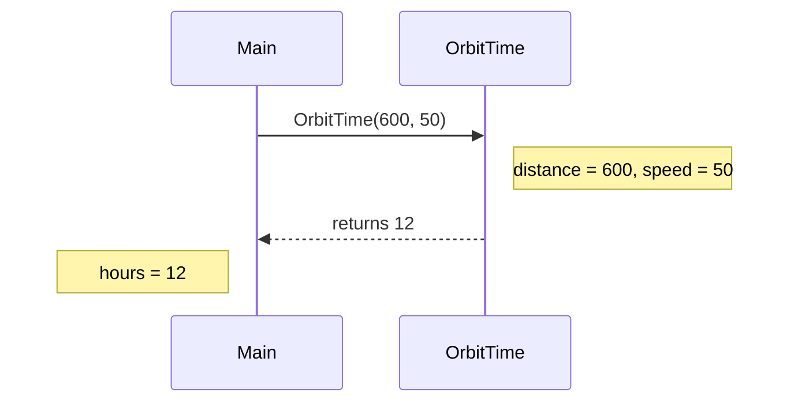

# Methods: naming a job so you can reuse it

A **method** is a named block of code that does one job. You write it once and **call** it whenever you need that job done, instead of copying the same lines around.

## Anatomy of a method

```csharp
static int OrbitTime(int distance, int speed)
{
    return distance / speed;
}
```

| Part | Meaning |
| --- | --- |
| `int` (before the name) | The **return type**: what kind of value the method hands back |
| `OrbitTime` | The method's name |
| `(int distance, int speed)` | The **parameters**: values the method needs to do its job |
| `return distance / speed;` | Hands the result back to whoever called the method |

(`static` lets `Main` call the method directly. You'll learn exactly what it means later.)

## Calling a method

```csharp
int hours = OrbitTime(600, 50);
Console.WriteLine(hours);   // 12
```

The values in the call, `600` and `50`, are called **arguments**. They fill the parameters in order: `distance` becomes 600 and `speed` becomes 50. The value the method returns, 12, is then stored in `hours`.



## `void`: methods that don't return anything

Some methods just **do** something, such as printing, and have no answer to give back. Their return type is `void`:

```csharp
static void Announce(string message)
{
    Console.WriteLine($"*** {message} ***");
}

Announce("Docking complete");   // nothing to store
```

## Methods calling methods

A method can call other methods. When the inner call finishes, the program **returns to exactly where it left off** and carries on:

```csharp
static void ArrivalRoutine()
{
    Announce("Arriving");
    Announce("Unloading");
}
```

> **Pilot's tip:** working something out isn't enough. If a method calculates a value, make sure it **returns that value**, and that the caller **uses** what comes back.

---

### Before you move on

- [ ] I can point out the return type, the name and the parameters of a method
- [ ] I know arguments fill the parameters in order
- [ ] I know `return` hands a value back, and `void` means nothing comes back
- [ ] I know the program carries on from where it was once a method call finishes
