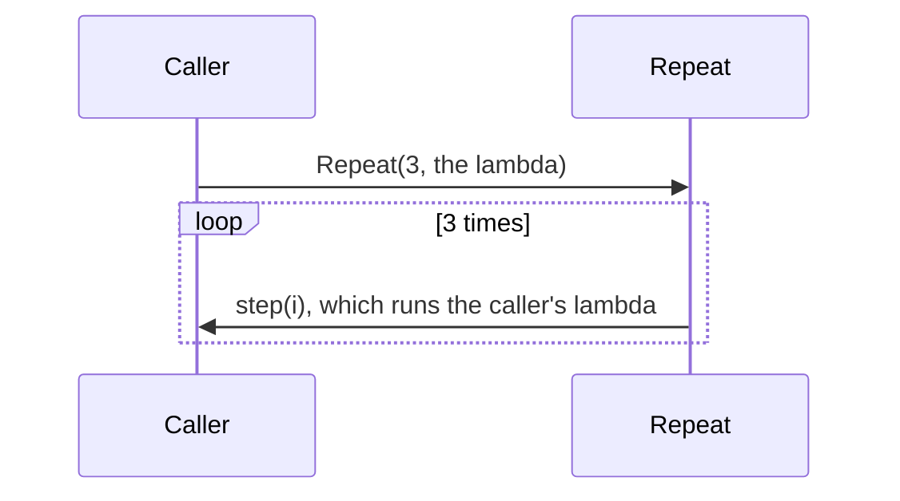

# Delegates and lambdas: methods as values

So far, variables have held data: numbers, text, objects. C# can also store **a method** in a variable, pass it to another method and call it later. That's how code says "here's **what to do**, you decide **when**". It's the foundation for events, which you'll meet next.

## `Action` and `Func`

C# has two ready-made delegate types:

| Type | Holds a method that… | Example |
| --- | --- | --- |
| `Action` | takes nothing, returns nothing | `Action beep` |
| `Action<string>` | takes a string, returns nothing | `Action<string> log` |
| `Func<int>` | takes nothing, returns an int | `Func<int> roll` |
| `Func<int, bool>` | takes an int, **returns a bool** | `Func<int, bool> isEven` |
| `Func<int, int, int>` | takes two ints, returns an int | `Func<int, int, int> add` |

With `Func`, **the last type is always the return type**.

```csharp
static void Siren() { Console.WriteLine("WOOO"); }

Action alarm = Siren;   // store the method itself: no brackets
alarm();                // call it through the variable: WOOO
```

## Lambdas: methods without a name

A **lambda** writes a small method right where you need it. `=>` separates the parameters from what the method does:

```csharp
Func<int, int> square = n => n * n;
Func<int, int, int> add = (a, b) => a + b;
Action<string> shout = text => Console.WriteLine(text.ToUpper());

square(4);        // 16
add(2, 3);        // 5
shout("engage");  // ENGAGE
```

Read `n => n * n` as "given `n`, give back `n * n`".

## Passing behaviour into a method

This is where delegates earn their keep. Write the loop once, and let the caller choose what happens to each item:

```csharp
static void Repeat(int times, Action<int> step)
{
    for (int i = 1; i <= times; i++) step(i);
}

Repeat(3, n => Console.WriteLine($"Pulse {n}"));
// Pulse 1, Pulse 2, Pulse 3
```



## Lambdas remember variables

A lambda can use variables from around it, and it uses **the variable itself**, not a snapshot of its value at the time:

```csharp
int bonus = 5;
Func<int, int> withBonus = x => x + bonus;
bonus = 50;
Console.WriteLine(withBonus(1));   // 51, not 6
```

> **Pilot's tip:** lambdas that are **created now but run later**, such as ones saved in a list inside a loop, see a variable's value **at the moment they run**. If each one needs its own value, copy the value into a fresh variable when you create the lambda.

---

### Before you move on

- [ ] I can read `Action<...>` and `Func<...>` types, and know the last `Func` type is the return type
- [ ] I can store a method in a variable and call it
- [ ] I can read a lambda such as `(a, b) => a + b`
- [ ] I know a lambda uses the variable itself, so it sees the value at the time it runs
