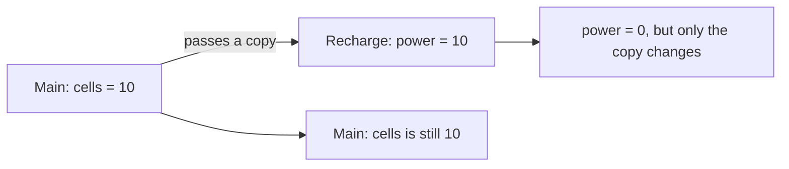

# Methods in depth: overloads, defaults and scope

You can write and call methods now. This briefing covers three things that come up in nearly every real program.

## Overloading: same name, different parameters

You can have several methods with the **same name**, as long as their **parameters differ** in number or type. C# picks the one that matches the arguments you pass:

```csharp
static double Area(double side)
{
    return side * side;
}

static double Area(double width, double height)
{
    return width * height;
}

Area(3);      // 9: the one-parameter version
Area(3, 4);   // 12: the two-parameter version
```

This is called **overloading**, and it's why `Console.WriteLine` can print text, numbers and booleans: it has a separate overload for each.

## Optional parameters

A parameter can have a **default value**, which is used when the caller leaves it out:

```csharp
static string Salute(string name, string rank = "Cadet")
{
    return $"{rank} {name}, report!";
}

Salute("Ari");                // "Cadet Ari, report!"
Salute("Ari", "Commander");   // "Commander Ari, report!"
```

Optional parameters always go **after** the required ones.

## Scope: where a variable exists

A variable only exists inside the block `{ }` where it was declared. That region is called its **scope**. Variables declared inside a method, including its parameters, are **local** to that method:

```csharp
static void Recharge(int power)
{
    int boosted = power * 2;   // only exists inside Recharge
    power = 0;                 // changes Recharge's own copy only
}
```

When you pass an `int`, the method gets a **copy** of the value. Changing the parameter changes the copy, never the caller's variable.



The way to get a result **out** of a method is to `return` it, and then **store** it:

```csharp
cells = Double(cells);   // store what comes back
```

> **Pilot's tip:** calling a method that returns a value, and then ignoring that value, is one of the most common bugs in any language.

---

### Before you move on

- [ ] I know overloads share a name and C# picks one by the arguments
- [ ] I can use a default value for an optional parameter
- [ ] I know local variables and parameters only exist inside their method
- [ ] I know a returned value has to be stored if you want to keep it
