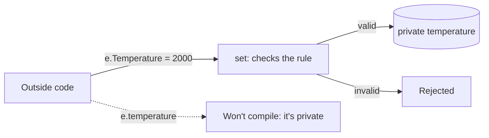

# Pillar 1: Encapsulation

So far every field has been `public`, so anyone can set a ship's fuel to `-400`. **Encapsulation** means keeping an object's data **sealed inside it** and only letting it change through members the class controls. The object protects its own rules.

## The four pillars of OOP

This is the first of the four big ideas you'll learn in the next quests:

| Pillar | In one line |
| --- | --- |
| **Encapsulation** | Hide the data; control how it changes |
| Inheritance | Build new classes on top of existing ones |
| Polymorphism | One call, different behaviour per object |
| Abstraction | Describe *what* must be done, not *how* |

## Access modifiers

| Modifier | Who can use the member |
| --- | --- |
| `public` | Any code, anywhere |
| `private` | Only code inside the same class (the default if you leave it out) |
| `protected` | The class and classes that inherit from it (next quest) |

## Properties: controlled doors

A **property** looks like a field from the outside, but runs code when it's read (`get`) or changed (`set`). Inside `set`, the keyword `value` holds the number being assigned.

```csharp
class Engine
{
    private int temperature;          // sealed in

    public int Temperature            // the controlled door
    {
        get { return temperature; }
        set
        {
            if (value > 900)
            {
                Console.WriteLine("Rejected: engine would melt");
            }
            else
            {
                temperature = value;
            }
        }
    }
}

Engine e = new Engine();
e.Temperature = 500;     // set runs: accepted
e.Temperature = 2000;    // set runs: rejected
// e.temperature = 2000; // won't compile: it's private
```



## Shorter forms

```csharp
public string Callsign { get; set; }          // auto-property: no rules, just a sealed field behind it
public int Id { get; }                        // read-only: can only be set in the constructor
public int Credits { get; private set; }      // anyone can read it, only this class can change it
```

A read-only property can also be written as `public int Id => id;`. The `=>` simply returns the value.

## Methods as the only way in

Often the best door isn't a setter at all, but a method that describes the action: `Deposit(amount)`, `TakeDamage(amount)`. The class then decides what's allowed.

> **Pilot's tip:** a rule is only as strong as its weakest door. If **any** code inside the class changes the private field directly, it skips the rule written in the property.

---

### Before you move on

- [ ] I can explain encapsulation in one sentence
- [ ] I know what `public`, `private` and `protected` allow
- [ ] I can read a property's `get` and `set`, and know `value` is the incoming number
- [ ] I know what `{ get; }` and `{ get; private set; }` allow
