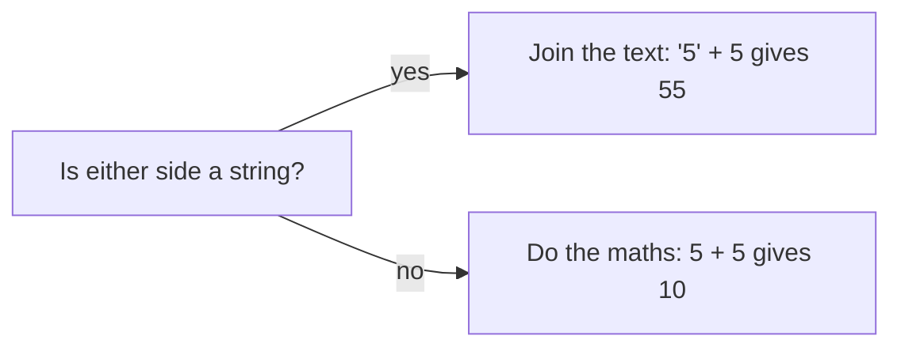

# Data types: what kind of value is this?

Every variable in C# has a **type**, and the type decides what the variable can hold and what you can do with it. Choose the wrong type and your numbers quietly lose their decimals, or the text "42" refuses to add up.

## The everyday types

| Type | Holds | Example |
| --- | --- | --- |
| `int` | Whole numbers | `int probes = 7;` |
| `double` | Numbers with a decimal part | `double gravity = 9.81;` |
| `bool` | `true` or `false` | `bool cloaked = false;` |
| `char` | A single character, in single quotes | `char grade = 'A';` |
| `string` | Text, in double quotes | `string planet = "Ares";` |

## Integer division

When **both** sides of a `/` are `int`s, C# does **integer division**: it drops the decimal part and doesn't round.

```csharp
Console.WriteLine(9 / 4);    // 2, not 2.25
Console.WriteLine(9.0 / 4);  // 2.25: one side is a double
```

The type of the variable you store the result in doesn't help, because the division has already happened by then:

```csharp
double result = 9 / 4;   // still 2: the int division ran first
```

## Converting between types

Sometimes you need a value as a different type.

**Casting** changes one number type into another. Put the type you want in brackets in front of the value:

```csharp
double distance = 7.99;
int whole = (int)distance;     // 7: the decimals are cut off, not rounded

int crew = 5;
double average = (double)crew / 2;  // 2.5
```

**Parsing** turns text into a number:

```csharp
string typed = "120";
int speed = int.Parse(typed);       // the number 120
double depth = double.Parse("3.5"); // the number 3.5
```

## Text and numbers don't mix the way you'd expect

`+` means **add** for two numbers, but **join** as soon as a string is involved:

```csharp
Console.WriteLine(5 + 5);      // 10
Console.WriteLine("5" + 5);    // 55: the text "5" followed by 5
```



> **Pilot's tip:** if a number shows up glued to some text, or loses its decimals, check the types on **both** sides of the operator.

---

### Before you move on

- [ ] I can name what `int`, `double`, `bool`, `char` and `string` hold
- [ ] I know why `9 / 4` gives `2`
- [ ] I know casting to `int` cuts off decimals, and `int.Parse` turns text into a number
- [ ] I know `+` joins text when a string is involved
