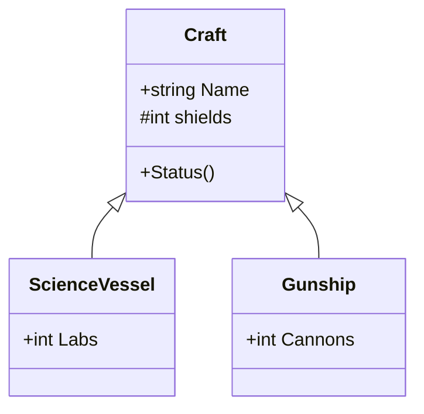

# Pillar 2: Inheritance

Freighters, fighters and science vessels are all ships: each has a name, a hull and a way to report its status. Without inheritance, you'd copy that code into every class, and fix every bug three times. **Inheritance** lets a class **build on top of** another one.

## Base class and derived class

```csharp
class Craft                          // the base class
{
    public string Name;
    protected int shields = 50;

    public Craft(string name)
    {
        Name = name;
    }

    public void Status()
    {
        Console.WriteLine($"{Name}: shields {shields}");
    }
}

class ScienceVessel : Craft          // derived from Craft
{
    public int Labs;

    public ScienceVessel(string name, int labs) : base(name)
    {
        Labs = labs;
        shields = 30;                // allowed: shields is protected
    }
}
```

- `ScienceVessel : Craft` means a ScienceVessel **is a** Craft.
- The derived class **inherits** everything the base class has (`Name`, `shields`, `Status()`) and adds its own members (`Labs`).
- `: base(name)` runs the **base class's constructor** first, passing it the values it needs.
- `protected` members are hidden from outside code but **visible to derived classes**.



(In the diagram, the arrow points from the derived class to its base, `+` means public and `#` means protected.)

```csharp
ScienceVessel lab = new ScienceVessel("Curie", 3);
lab.Status();    // inherited from Craft: "Curie: shields 30"
```

## Constructors run from the base up

Creating a derived object **always** runs the base constructor first, then the derived one. With a chain of classes (A, then B : A, then C : B), creating a `C` runs A's constructor, then B's, then C's.

## "Is a" means it fits

Because a ScienceVessel **is a** Craft, it can go anywhere a Craft is expected:

```csharp
Craft any = new ScienceVessel("Curie", 3);
Console.WriteLine(any is ScienceVessel);   // True: the object hasn't changed
```

> **Pilot's tip:** with `: base(...)`, check that the derived constructor passes **its own parameters** on to the base, and not hard-coded values by mistake.

---

### Before you move on

- [ ] I know `Derived : Base` means the derived class inherits the base's members
- [ ] I know `: base(...)` passes values to the base constructor, which runs first
- [ ] I know `protected` members can be used by derived classes but not by outside code
- [ ] I know a derived object can be stored in a base-type variable ("is a")
