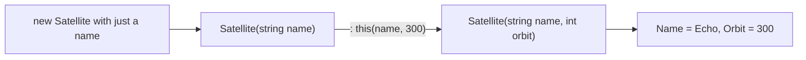

# Constructors: every object set up from the start

Setting fields one by one after `new` works, but it's easy to forget one, and then a ship launches with no name. A **constructor** is a special method that runs **automatically** whenever an object is created, so every object starts out complete.

## Writing a constructor

```csharp
class Satellite
{
    public string Name;
    public int Orbit;
    public bool Online;

    public Satellite(string name, int orbit)
    {
        Name = name;
        Orbit = orbit;
        Online = true;      // every satellite starts online
    }
}

Satellite relay = new Satellite("Relay-7", 400);
```

A constructor:

- has **the same name as the class**
- has **no return type**, not even `void`
- runs **once per object**, at the moment of `new`
- takes parameters that you pass inside `new Satellite(...)`

When a class has a constructor with parameters, `new Satellite()` with nothing in the brackets no longer compiles. The class now **insists** on a name and an orbit.

## `this`: the object being built

When a parameter has the same name as a field, the parameter **hides** the field inside the constructor. `this.` means "the field on this object":

```csharp
class Moon
{
    public string name;
    public int radius;

    public Moon(string name, int radius)
    {
        this.name = name;       // the object's field = the parameter
        this.radius = radius;
    }
}
```

Without `this.`, `name = name` would just copy the parameter onto itself, and the field would never be set.

## Several constructors (overloading)

Like methods, constructors can be overloaded. Use `: this(...)` to make one constructor **call another**, so the set-up code only lives in one place:

```csharp
class Satellite
{
    public string Name;
    public int Orbit;

    public Satellite(string name, int orbit)
    {
        Name = name;
        Orbit = orbit;
    }

    // A default orbit of 300, passed on to the main constructor
    public Satellite(string name) : this(name, 300) { }
}
```



> **Pilot's tip:** if a field comes out empty or zero when it shouldn't, look at the constructor and check that every value actually reaches **the object's field**.

---

### Before you move on

- [ ] I know a constructor shares the class's name, has no return type and runs on `new`
- [ ] I know why `this.` is needed when a parameter has the same name as a field
- [ ] I can follow `: this(...)` from one constructor to another
