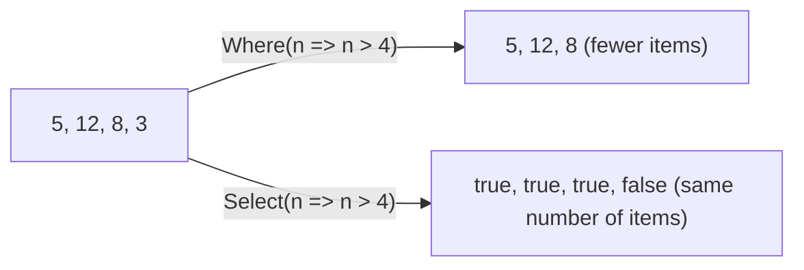

# LINQ: asking questions of a collection

"Which planets are habitable?", "What's the total cargo weight?", "Sort the crew by rank." Each of these takes a loop, a temporary list and a few `if`s. **LINQ** (Language Integrated Query) answers them in one readable line, using the lambdas you learned in Relay Signals.

## Setting up

```csharp
using System.Linq;   // adds the LINQ methods to every list and array
```

## The core methods

Every one of these takes a lambda that says what to do with **each item**:

| Method | What it does | Example (on `{ 5, 12, 8, 3 }`) | Result |
| --- | --- | --- | --- |
| `Where` | **Keeps** the items where the lambda is true | `.Where(n => n > 4)` | `5, 12, 8` |
| `Select` | **Transforms** every item into something else | `.Select(n => n * 2)` | `10, 24, 16, 6` |
| `OrderBy` | Sorts, smallest first | `.OrderBy(n => n)` | `3, 5, 8, 12` |
| `OrderByDescending` | Sorts, largest first | `.OrderByDescending(n => n)` | `12, 8, 5, 3` |

And some that give a **single answer**:

| Method | Gives | Example | Result |
| --- | --- | --- | --- |
| `Count()` / `Count(test)` | How many (that match) | `.Count(n => n > 4)` | `3` |
| `Sum(...)` | The total | `.Sum()` | `28` |
| `Any(test)` | Does **at least one** match? | `.Any(n => n > 10)` | `true` |
| `All(test)` | Do **all** match? | `.All(n => n > 1)` | `true` |
| `First()` | The first item (💥 throws if there are none) | `.First()` | `5` |

## `Where` vs `Select`

These two are easy to mix up, so look closely:



`Where` **filters**: you get back some of the original items. `Select` **maps**: you get back one result for **every** item.

## Chaining

Each step works on the result of the step before it:

```csharp
var names = crew
    .Where(c => c.Rank >= 3)          // officers only
    .OrderBy(c => c.Name)             // alphabetical
    .Select(c => c.Name);             // just their names

Console.WriteLine(string.Join(", ", names));
```

`var` tells C# to work out the variable's type for you. It's handy because LINQ's result types can get long. `.ToList()` at the end turns a result into a `List`.

LINQ never changes the original collection. It always produces a **new** result.

> **Pilot's tip:** read a chain out loud: "from the crew, **where** rank is 3 or more, **order by** name, **select** the name." If the sentence sounds wrong, so is the query.

---

### Before you move on

- [ ] I know `Where` filters and `Select` transforms every item
- [ ] I can sort with `OrderBy` and `OrderByDescending`
- [ ] I can use `Count`, `Sum`, `Any` and `First`
- [ ] I can read a chained query step by step
