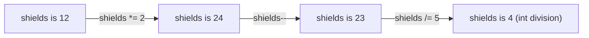

# Operators: doing the maths

Operators are the symbols that work values out: adding, comparing, updating. C# follows strict rules about **which operator goes first**, and most maths bugs come from forgetting them.

## Arithmetic operators

| Operator | Meaning | Example | Result |
| --- | --- | --- | --- |
| `+` | Add | `8 + 3` | `11` |
| `-` | Subtract | `8 - 3` | `5` |
| `*` | Multiply | `8 * 3` | `24` |
| `/` | Divide | `8 / 3` | `2` (both are ints, so the decimal part is dropped) |
| `%` | **Remainder** (modulo) | `8 % 3` | `2` |

`%` gives what's **left over** after dividing. 8 split into groups of 3 makes two groups, with 2 left over. It's handy for things like "is this number even?" (`n % 2 == 0`) or "every 5th turn".

## Order of operations

C# follows the same order you learned in maths:

1. Anything in **brackets** `( )` first
2. Then `*`, `/` and `%`
3. Then `+` and `-`
4. Operators at the same level are worked out **left to right**

```csharp
int a = 10 - 4 / 2;     // 4 / 2 first, then 10 - 2 = 8
int b = (10 - 4) / 2;   // the brackets first: 6 / 2 = 3
int c = 20 / 2 * 5;     // left to right: 10 * 5 = 50
```

When in doubt, **add brackets**. They make your intent obvious and cost nothing.

## Updating a variable

Updating a variable based on its own value is so common that C# has shortcuts for it:

| Shortcut | Same as |
| --- | --- |
| `shields += 5;` | `shields = shields + 5;` |
| `shields -= 5;` | `shields = shields - 5;` |
| `shields *= 2;` | `shields = shields * 2;` |
| `shields /= 2;` | `shields = shields / 2;` |
| `shields++;` | `shields = shields + 1;` |
| `shields--;` | `shields = shields - 1;` |

Each one reads the **current** value, works out the new one and stores it back:



> **Pilot's tip:** when you trace code with several updates, write down the variable's value after **every** line. It's slower than guessing, but you'll never be wrong.

---

### Before you move on

- [ ] I know `%` gives the remainder
- [ ] I know `*`, `/` and `%` happen before `+` and `-`, unless brackets say otherwise
- [ ] I can trace `+=`, `-=`, `*=`, `/=`, `++` and `--` step by step
