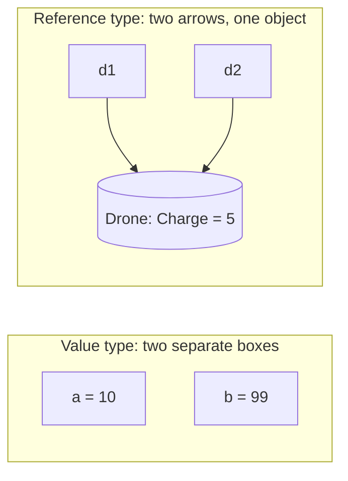

# Value types and reference types

Sometimes copying a variable gives you an independent copy, and sometimes it gives you **a second name for the same thing**. Which one you get depends on the type, and mixing them up causes some of the most confusing bugs in C#.

## Value types hold the value itself

`int`, `double`, `bool`, `char`, enums and **structs** are **value types**. The variable holds the actual data, so assigning one to another **copies the data**:

```csharp
int a = 10;
int b = a;    // b gets its own copy of 10
b = 99;       // a is still 10
```

## Reference types point at an object

Classes (and `string`, `List`, arrays) are **reference types**. The object lives elsewhere in memory, and the variable holds a **reference**: an address pointing at it. Assigning copies **the reference**, so both variables point at **the same object**:

```csharp
class Drone { public int Charge; }

Drone d1 = new Drone { Charge = 50 };
Drone d2 = d1;        // d2 points at the SAME drone
d2.Charge = 5;        // d1.Charge is now 5 as well
```



## Structs vs classes

A `struct` looks like a class but is a **value type**. It's best for small bundles of data, such as a point or a colour:

```csharp
struct Vector
{
    public int X;
    public int Y;
}

Vector v1 = new Vector { X = 1, Y = 1 };
Vector v2 = v1;    // a full copy
v2.X = 8;          // v1.X is still 1
```

## Passing to methods

This affects method calls in the same way. A method that gets a **value type** gets a copy, so changes stay inside the method. A method that gets a **reference type** gets a copy of the **reference**, which still points at the caller's object, so changes to that object's fields **are** seen by the caller.

## `null`: a reference to nothing

A reference-type variable can be `null`, meaning it points at no object at all. Using a member of `null` throws a **`NullReferenceException`**:

```csharp
Drone missing = null;
Console.WriteLine(missing == null);   // True
// missing.Charge = 1;               // 💥 NullReferenceException
```

A field of a class type starts as `null` until **something assigns it an object**.

> **Pilot's tip:** with a `NullReferenceException`, don't stare at the line that crashed. Find where the variable **should** have been given an object, and work out why it wasn't.

---

### Before you move on

- [ ] I know assigning a value type copies the data
- [ ] I know assigning a reference type copies the reference, so both variables share one object
- [ ] I know a `struct` is a value type and a `class` is a reference type
- [ ] I know what `null` means and what causes a `NullReferenceException`
