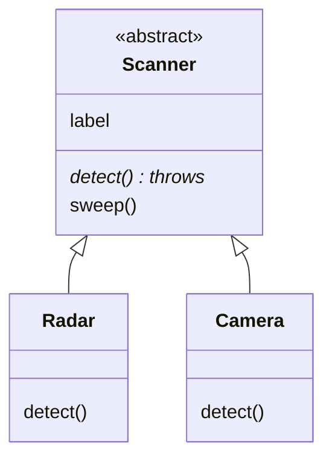

# Pillar 4: Abstraction

Some classes describe an idea that's too general to exist on its own. There's no such thing as just "a sensor": there are thermometers, radar and cameras. **Abstraction** means defining **what** every kind of sensor must be able to do, while leaving **how** to each specific one.

Languages such as C# have an `abstract` keyword. JavaScript doesn't, so classes enforce the rules themselves, with two well-known patterns.

## Pattern 1: stop the base class being created

`new.target` is the class that `new` was actually used with. A base class can refuse to be built directly:

```js
class Scanner {
  constructor(label) {
    if (new.target === Scanner) {
      throw new Error("Scanner is abstract: build a specific scanner");
    }
    this.label = label;
  }
}
```

`new Radar()` passes, because `new.target` is `Radar`. `new Scanner()` throws.

## Pattern 2: methods that must be replaced

The base class provides a method that only **throws**, meaning "every subclass must override me":

```js
class Scanner {
  // ...constructor as above...

  detect() {
    throw new Error(`${this.constructor.name} must implement detect()`);
  }

  // Shared behaviour, written once, relying on detect()
  sweep() {
    console.log(`[${this.label}] ${this.detect()}`);
  }
}

class Radar extends Scanner {
  constructor() { super("Radar"); }
  detect() { return "3 contacts bearing north"; }
}

new Radar().sweep();   // [Radar] 3 contacts bearing north
```

`this.constructor.name` is the name of the object's class, which makes the error message say exactly which class forgot.



## Why throw, rather than return a default?

A made-up default (returning `0`, or `""`) lets a forgotten override slip through **silently**: the program keeps running with a wrong value. Throwing makes the mistake loud the very first time it happens.

| Base method… | A subclass forgets to override it… |
| --- | --- |
| returns a default | Wrong results, and nothing tells you |
| throws an error | An error names the class that forgot |

Getters can use the same pattern: `get reward() { throw new Error(...) }`.

---

### Before you move on

- [ ] I can explain abstraction: define *what*, leave *how* to subclasses
- [ ] I know how a `new.target` check stops the base class being created
- [ ] I know why a "must implement" method throws instead of returning a default
- [ ] I know shared methods in the base class can rely on methods the subclasses provide
