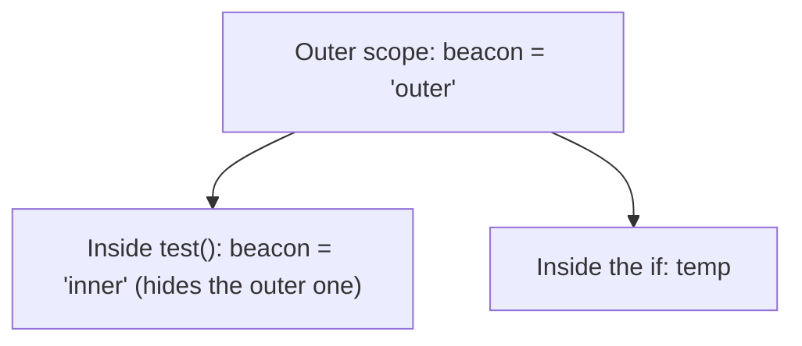

# Functions in depth: arrows, defaults and scope

You can write and call functions now. Modern JavaScript adds a shorter way to write them, default values for parameters, and clear rules about where a variable exists.

## Arrow functions

Arrow functions are a shorter way to write a function, stored in a variable:

```js
// A normal function
function square(n) {
  return n * n;
}

// The same thing as an arrow function
const squareArrow = (n) => n * n;
```

| Form | Example | Returns |
| --- | --- | --- |
| One expression after `=>` | `(a, b) => a + b` | The expression's value, **automatically** |
| A body in braces | `(a, b) => { const sum = a + b; return sum; }` | **Only** what you `return` |
| No parameters | `() => "ready"` | `"ready"` |

The braces are the catch: as soon as an arrow function has `{ }`, it behaves like a normal function body and needs an explicit `return`.

## Default parameters

A parameter can have a default, used when the caller leaves it out (or passes `undefined`):

```js
const salute = (name, rank = "Cadet") => `${rank} ${name}, report!`;

salute("Ari");              // "Cadet Ari, report!"
salute("Ari", "Captain");   // "Captain Ari, report!"
```

## Scope: where a variable exists

A variable made with `let` or `const` only exists inside the **block** `{ }` it was declared in: a function, an `if` or a loop.

```js
const beacon = "outer";

function test() {
  const beacon = "inner";   // a separate variable that hides the outer one
  console.log(beacon);      // "inner"
}

test();
console.log(beacon);        // "outer": untouched

if (true) {
  const temp = 5;
}
// console.log(temp);       // ReferenceError: temp only existed in the if
```



Passing a number into a function gives it a **copy**: changing the parameter never changes the caller's variable. To get a result out, `return` it and store it.

> **Pilot's tip:** an arrow function in braces that comes back `undefined` is nearly always missing its `return`.

---

### Before you move on

- [ ] I can read arrow functions with and without braces, and know when `return` is needed
- [ ] I can use default parameters
- [ ] I know `let` and `const` only exist inside their block
- [ ] I know an inner variable with the same name hides the outer one
