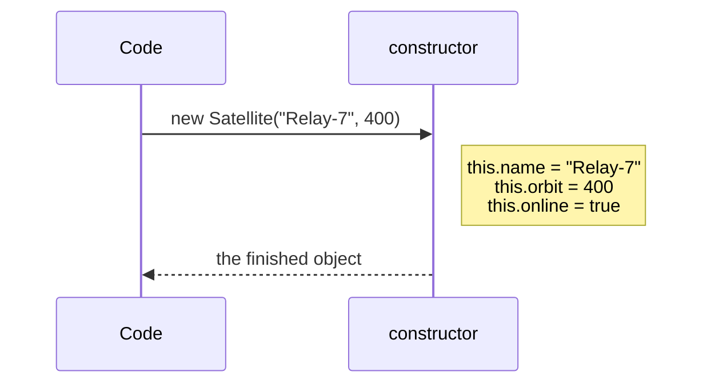

# Constructors: every object set up from the start

Setting fields one at a time after `new` works, but it's easy to forget one, and then a ship launches with no name. A **constructor** is a special method that runs **automatically** whenever `new` builds an object, so every object starts out complete.

## Writing a constructor

```js
class Satellite {
  constructor(name, orbit) {
    this.name = name;
    this.orbit = orbit;
    this.online = true;    // every satellite starts online
  }

  status() {
    return `${this.name} at ${this.orbit} km: ${this.online ? "online" : "offline"}`;
  }
}

const relay = new Satellite("Relay-7", 400);
console.log(relay.status());   // "Relay-7 at 400 km: online"
```

- It's always called `constructor`.
- It runs **once per object**, at the moment of `new`.
- The arguments in `new Satellite(...)` are passed to it.
- **`this.name = name`** stores the parameter on the new object. The parameter on its own disappears when the constructor ends; only what's assigned to `this` stays with the object.



## Default values

Constructor parameters can have defaults, just like any function:

```js
class Probe {
  constructor(target = "deep space", range = 500) {
    this.target = target;
    this.range = range;
  }
}

new Probe("Titan", 120);   // target "Titan", range 120
new Probe();               // target "deep space", range 500
```

A default is used when the argument is missing **or** `undefined`, so `new Probe(undefined, 50)` keeps the default target but changes the range.

## Constructors and fields together

Fields declared at the top of the class are set up first, then the constructor runs. Use fields for fixed starting values, and the constructor for values that come from arguments.

> **Pilot's tip:** if a property comes out `undefined`, check that the constructor stores it on **`this`**.

---

### Before you move on

- [ ] I know the constructor runs automatically on `new` and receives its arguments
- [ ] I know values must be stored on `this` to stay with the object
- [ ] I can give constructor parameters default values
