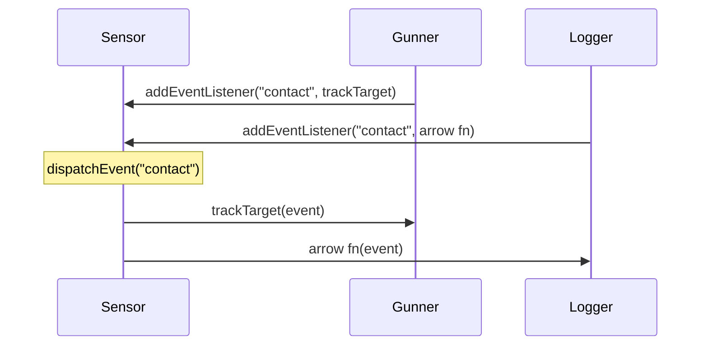

# Script communication 3: events

With references, objects talk directly: the hull **knows about** the shield. Sometimes an object should simply **announce** that something happened, without knowing or caring who's listening. That's an **event**. It's how buttons, games and most of the browser let their scripts talk to each other.

## `EventTarget`: something that can be listened to

```js
const sensor = new EventTarget();

function trackTarget(event) {
  console.log(`Gunner tracking at ${event.detail} km`);
}

sensor.addEventListener("contact", trackTarget);               // subscribe a named function
sensor.addEventListener("contact", (event) => {                // or an arrow function
  console.log(`Log: contact at ${event.detail} km`);
});

sensor.dispatchEvent(new CustomEvent("contact", { detail: 300 }));
// Gunner tracking at 300 km
// Log: contact at 300 km
```

| Piece | What it does |
| --- | --- |
| `addEventListener(name, fn)` | Subscribes `fn` to events with that name |
| `dispatchEvent(event)` | Announces an event: calls every listener for its name, in the order they were added |
| `new CustomEvent(name, { detail })` | An event carrying your own data in `detail` |
| `removeEventListener(name, fn)` | Unsubscribes `fn` |



`dispatchEvent` calls the listeners **straight away**, before the next line runs. The sensor never mentions the gunner or the logger, so you can add more listeners later **without changing the sensor**. This is called **loose coupling**.

## Your own classes can send events

```js
class Reactor extends EventTarget {
  overheat() {
    this.dispatchEvent(new CustomEvent("overheat", { detail: 140 }));
  }
}
```

## Removing a listener: it must be the same function

`removeEventListener` removes **the exact function** that was added. Two arrow functions written out separately are **two different functions**, even if their code looks identical:

```js
const onContact = (event) => console.log(event.detail);
sensor.addEventListener("contact", onContact);
sensor.removeEventListener("contact", onContact);   // ✔ the same function
```

So if you'll need to remove a listener, store it in a variable first. (Adding the exact same function twice is ignored, so it can't run twice.)

> **Pilot's tip:** if a listener "won't go away", check that `removeEventListener` is given the very same function object that `addEventListener` was.

---

### Before you move on

- [ ] I can subscribe with `addEventListener` and announce with `dispatchEvent`
- [ ] I can send data with `CustomEvent` and read it from `event.detail`
- [ ] I know listeners run in order, straight away, and the sender doesn't know who they are
- [ ] I know removing a listener needs the same function that was added
