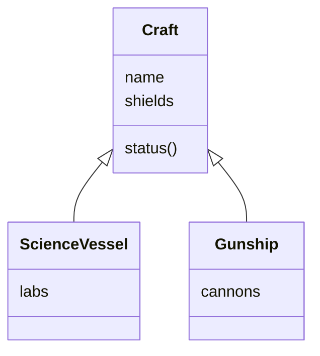

# Pillar 2: Inheritance

Freighters, fighters and science vessels are all ships: each has a name, a hull and a status report. Without inheritance, you'd copy that code into every class, and fix every bug three times. **Inheritance** lets a class build on top of another.

## `extends` and `super`

```js
class Craft {
  constructor(name) {
    this.name = name;
    this.shields = 50;
  }

  status() {
    return `${this.name}: shields ${this.shields}`;
  }
}

class ScienceVessel extends Craft {
  constructor(name, labs) {
    super(name);          // run Craft's constructor first
    this.labs = labs;     // then add what's special to this class
    this.shields = 30;
  }
}

const curie = new ScienceVessel("Curie", 3);
console.log(curie.status());   // "Curie: shields 30": status is inherited
```

- `ScienceVessel extends Craft` means a ScienceVessel **is a** Craft. It inherits Craft's methods and gets everything Craft's constructor sets up.
- `super(...)` calls the **parent's constructor** with the values it needs.
- In a class that `extends`, **`super()` must run before `this` is used**. The object doesn't exist until the parent has built it, so touching `this` first throws a `ReferenceError`.



(The arrow points from each child class to the parent it extends.)

## Constructors run from the top down

With a chain (C extends B, and B extends A), each constructor calls `super()` first, so creating a `C` runs A's constructor body, then B's, then C's.

## "Is a" and `instanceof`

A child object is an instance of its own class **and** of every ancestor:

```js
curie instanceof ScienceVessel;   // true
curie instanceof Craft;           // true
```

> **Pilot's tip:** in a class that `extends`, make `super(...)` the first line of the constructor.

---

### Before you move on

- [ ] I know `extends` makes a class inherit its parent's methods
- [ ] I know `super(...)` runs the parent constructor, and must come before `this`
- [ ] I know constructors run from the top of the chain down
- [ ] I know `instanceof` is true for the class and all its ancestors
