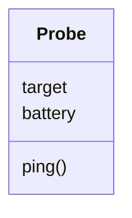

# Classes and objects: blueprints and ships

Object literals are great for one-offs, but a fleet of twenty ships needs twenty objects with the same shape and the same behaviour. A **class** is a blueprint: it describes what every object of its kind *has* and *does*, and `new` builds objects from it.

## Writing a class

```js
class Probe {
  // Fields: what every probe HAS (with starting values)
  target = "unassigned";
  battery = 100;

  // Methods: what every probe can DO
  ping() {
    this.battery -= 5;
    console.log(`Ping from ${this.target}. Battery: ${this.battery}`);
  }
}
```



## Building objects with `new`

```js
const alpha = new Probe();
alpha.target = "Europa";

const beta = new Probe();
beta.target = "Io";

alpha.ping();   // Ping from Europa. Battery: 95
beta.ping();    // Ping from Io. Battery: 95
alpha.ping();   // Ping from Europa. Battery: 90
```

- `new Probe()` creates a **new object** with its own copy of every field.
- Each object is independent: pinging `alpha` doesn't drain `beta`.
- **Inside a method, fields are always reached through `this`**: `this.battery`, never just `battery`. `this` is the object the method was called on.

## Checking what something is

```js
alpha instanceof Probe;   // true: alpha was built from Probe
typeof Probe;             // "function": a class is a special function underneath
```

## Classes and arrays

Objects made from a class work with everything you've learned so far:

```js
const swarm = [new Probe(), new Probe()];
swarm.forEach((probe, i) => {
  probe.target = `Moon ${i + 1}`;
});
swarm.forEach((probe) => probe.ping());
```

> **Pilot's tip:** a `ReferenceError` inside a method about a name you *know* is a field usually means `this.` is missing.

---

### Before you move on

- [ ] I can explain the difference between a class and an object
- [ ] I can write fields and methods, and create objects with `new`
- [ ] I know each object has its own copy of the fields
- [ ] I know methods reach fields through `this`
