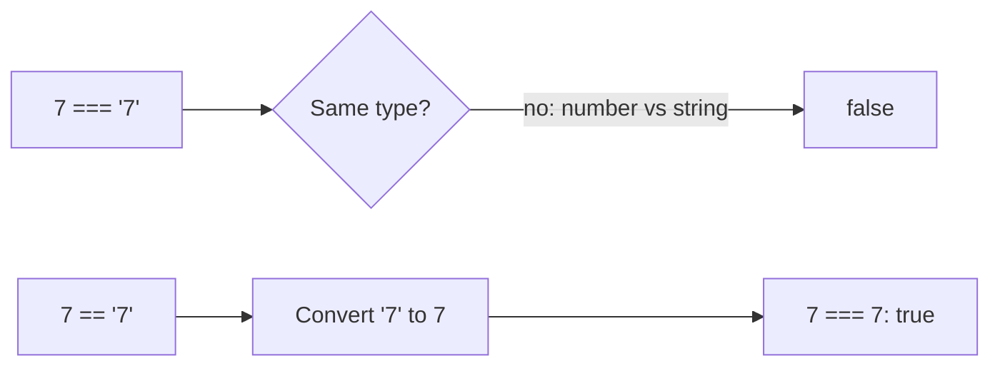

# Operators: maths and comparisons

Operators are the symbols that work values out and compare them. JavaScript follows strict rules about **which goes first**, and it has two kinds of equals: that's where many bugs hide.

## Arithmetic

| Operator | Meaning | Example | Result |
| --- | --- | --- | --- |
| `+` `-` `*` | Add, subtract, multiply | `6 * 3` | `18` |
| `/` | Divide (decimals are kept) | `9 / 2` | `4.5` |
| `%` | **Remainder** | `9 % 2` | `1` |
| `**` | Power | `3 ** 2` | `9` |

`%` gives what's left over after dividing, which makes it handy for "is it even?" (`n % 2 === 0`) or "every 3rd turn".

## Order of operations

1. Brackets `( )` first
2. Then `**`
3. Then `*`, `/` and `%`
4. Then `+` and `-`
5. Equal levels go left to right

```js
console.log(10 - 6 / 2);     // 7: the division happens first
console.log((10 - 6) / 2);   // 2: brackets first
```

If you're not sure, add brackets: they make your intent clear.

## Updating a variable

| Shortcut | Same as |
| --- | --- |
| `x += 3` | `x = x + 3` |
| `x -= 3` | `x = x - 3` |
| `x *= 3` | `x = x * 3` |
| `x /= 3` | `x = x / 3` |
| `x++` / `x--` | add / take away 1 |

## Comparing: `==` vs `===`

Comparisons give `true` or `false`. JavaScript has **two** kinds of equality:

| Operator | Name | `5 ? "5"` gives |
| --- | --- | --- |
| `==` | Loose equality: converts types first, then compares | `true` |
| `===` | **Strict** equality: the type must match as well | `false` |
| `!=` / `!==` | Not equal (loose / strict) | `false` / `true` |
| `<` `>` `<=` `>=` | Less / greater (or equal) | |

Loose equality has some famous oddities (`0 == ""` is `true`!). **Always use `===` and `!==`** unless you have a very good reason not to.



> **Pilot's tip:** to trace several updates, write down the variable's value after every line.

---

### Before you move on

- [ ] I know `%` gives the remainder and `**` a power
- [ ] I know the order of operations, and that brackets go first
- [ ] I can trace `+=`, `*=`, `++` and `--`
- [ ] I know why `===` is safer than `==`
