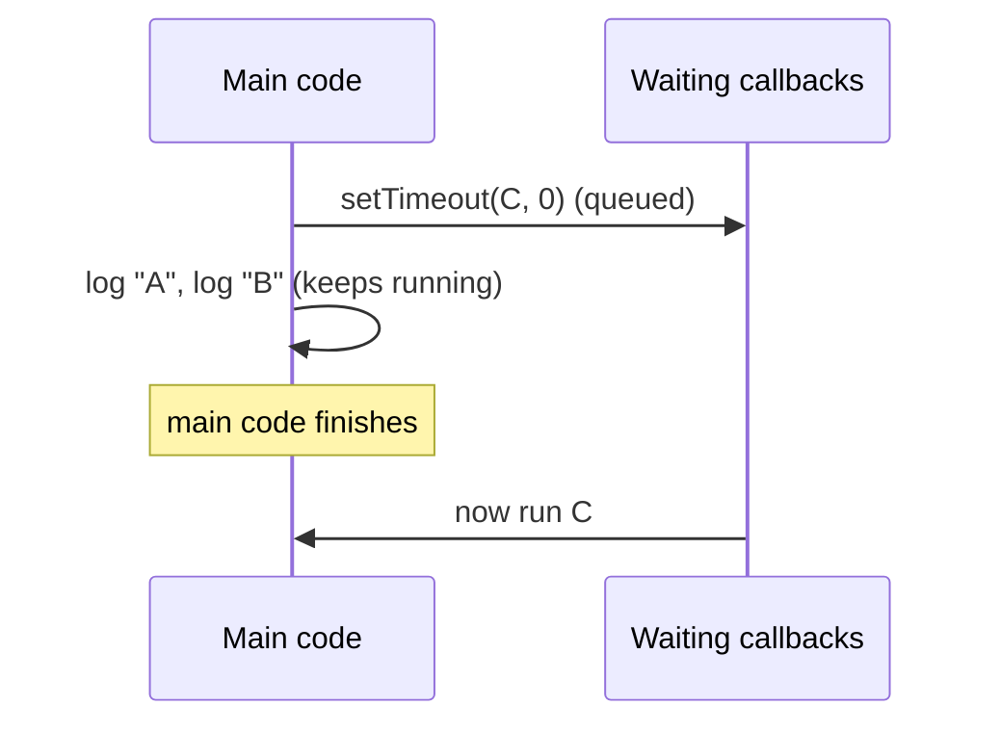

# Callbacks and the event loop

Functions in JavaScript are values: you can pass one into another function, which calls it back later. That passed-in function is a **callback**. Callbacks are how JavaScript handles things that take time, and they explain why logs sometimes come out "in the wrong order".

## Passing behaviour in

```js
function repeat(times, action) {
  for (let i = 1; i <= times; i++) {
    action(i);                    // call the function we were given
  }
}

repeat(3, (n) => console.log(`Pulse ${n}`));
// Pulse 1, Pulse 2, Pulse 3
```

The caller decides **what** happens; `repeat` decides **when**. You've already used callbacks with `map`, `filter` and `forEach`.

## Callbacks that run later: `setTimeout`

```js
console.log("A");
setTimeout(() => console.log("C"), 1000);
console.log("B");
// A, B, then C a second later
```

`setTimeout` **doesn't pause** the program. It hands the callback over to be run later, and the code carries on straight away.

## The event loop

JavaScript runs **one thing at a time**. When the code that's running now has finished, the **event loop** picks up waiting callbacks, one by one:



So even `setTimeout(fn, 0)` waits until the current code is done. The delay is a **minimum**, not an exact time.

```js
setTimeout(() => console.log("later"), 0);
console.log("now");
// now, later
```

## Using a result that arrives later

If a value only arrives inside a callback, **code that needs it must run inside that callback too** (or be called from it). Code written below the call runs **before** the callback does:

```js
let reading = "none";
getReadingLater((value) => {
  reading = value;
  console.log(`Got ${value}`);   // ✔ runs once the value has arrived
});
console.log(reading);            // ✘ runs first: still "none"
```

> **Pilot's tip:** to predict the order of logs, finish **all** the main code first, then run the callbacks: the earliest timer first.

---

### Before you move on

- [ ] I can pass a function as a callback and know who decides when it runs
- [ ] I know `setTimeout` schedules a callback and the code carries on immediately
- [ ] I can explain why a 0 ms timer still runs after the current code
- [ ] I know code that needs a late result must run inside the callback
