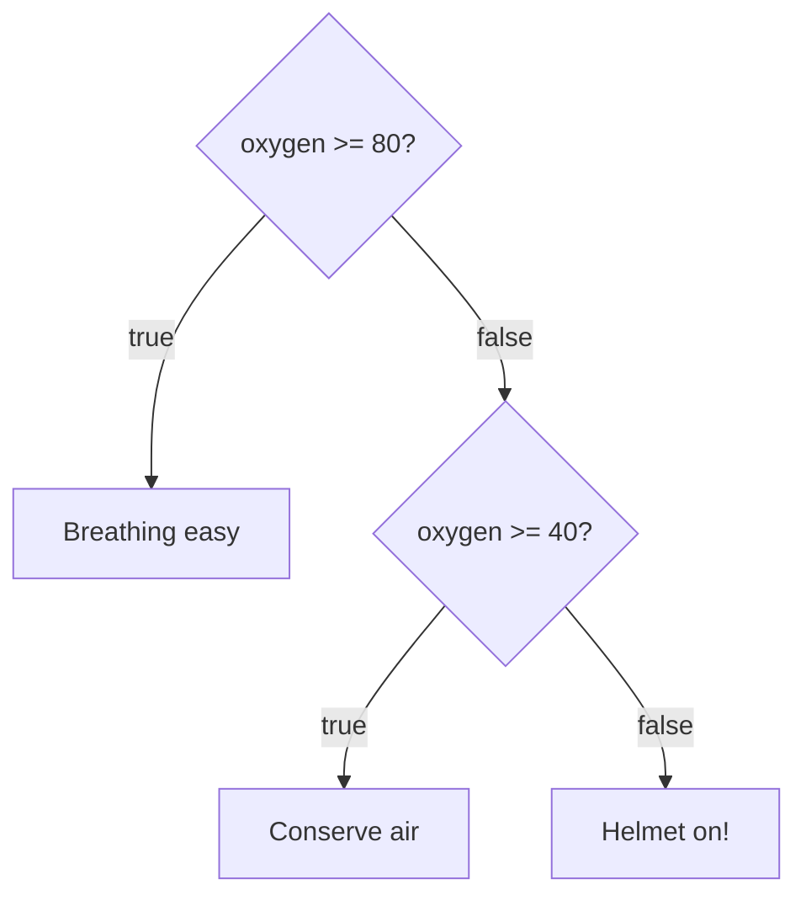

# Conditionals: making decisions

Programs react to what's happening: raise the shields **if** an enemy appears, **otherwise** keep cruising. In JavaScript, that's `if`, `else if` and `else`.

## `if`, `else if`, `else`

```js
const oxygen = 45;

if (oxygen >= 80) {
  console.log("Breathing easy");
} else if (oxygen >= 40) {
  console.log("Conserve air");
} else {
  console.log("Helmet on!");
}
```

The conditions are checked **from the top**, and **only the first true one runs**. The rest of the chain is then skipped, so **the order matters**.



## `=` is not `===`

`=` **stores** a value; `===` **compares**. Putting `=` in a condition is a classic bug:

```js
if (mode = "attack") { ... }   // stores "attack" in mode, and is always true!
if (mode === "attack") { ... } // compares
```

## Combining conditions

| Operator | True when… |
| --- | --- |
| `a && b` | **both** are true |
| `a \|\| b` | **at least one** is true |
| `!a` | `a` is false |

## Truthy and falsy

An `if` doesn't need a real `true`/`false`. Every value counts as one or the other. These are **falsy**:

`false`, `0`, `""` (empty string), `null`, `undefined`, `NaN`

**Everything else is truthy**, including `"0"`, `"false"` and `[]`.

```js
const callsign = "";
if (callsign) {
  console.log(`Hello ${callsign}`);
} else {
  console.log("No callsign yet");   // runs: "" is falsy
}
```

## The ternary: a short if/else that gives a value

```js
const label = fuel > 20 ? "OK" : "LOW";
```

Read it as "**if** fuel > 20, **then** `"OK"`, **else** `"LOW"`".

> **Pilot's tip:** check the edges. Does `> 30` include 30? (It doesn't, but `>= 30` does.)

---

### Before you move on

- [ ] I know only the first true branch of an `if` chain runs
- [ ] I know `=` stores and `===` compares
- [ ] I can work out `&&`, `||` and `!`
- [ ] I can list the falsy values and read a ternary
