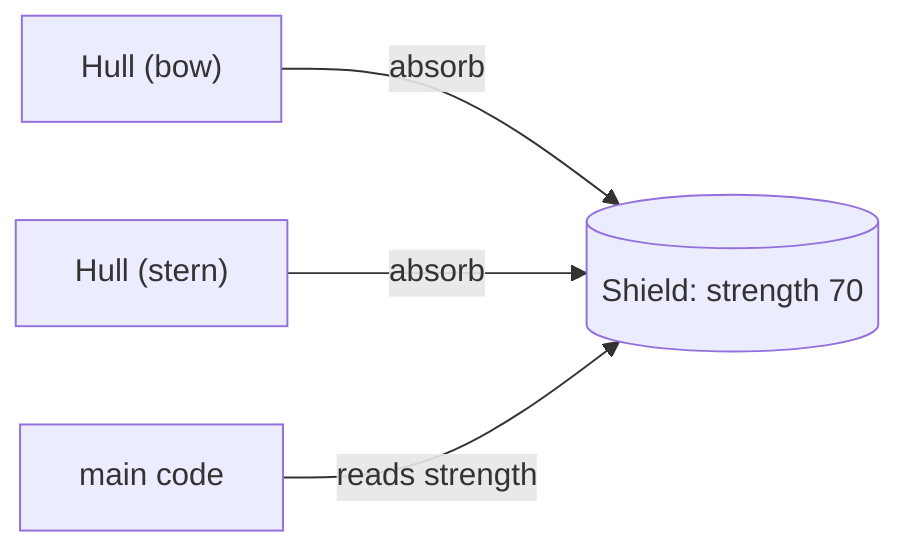

# Script communication 1: objects talking to objects

Real programs, and game or web projects where each script is a class, aren't one big object. They're many small objects that **cooperate**. To cooperate, an object needs a way to reach the others: it holds a **reference** to them and **calls their methods**.

## Holding a reference

An object can keep another object in a property, and call its methods whenever it needs to:

```js
class Shield {
  strength = 100;

  absorb(hit) {
    this.strength -= hit;
  }
}

class Hull {
  constructor(shield) {
    this.shield = shield;      // handed over when the hull is built
  }

  takeHit(damage) {
    this.shield.absorb(damage);   // talking to the other object
  }
}
```

## Passing one object to several others

Objects are shared by reference, so **passing the same object** to several others means they all work with it:

```js
const shared = new Shield();
const bow = new Hull(shared);
const stern = new Hull(shared);

bow.takeHit(10);
stern.takeHit(20);
console.log(shared.strength);   // 70: one shield, hit twice
```



If one of them is given its **own** `new Shield()` instead, it's talking to a different object, and the others never hear about it.

## Composition: "has a"

Inheritance says a Fighter **is a** Ship. **Composition** says a Ship **has** an Engine, a Radio and Sensors, and gets its work done by asking them:

```js
class Bridge {
  #sensors = new Sensors();
  #helm = new Helm();

  avoidCollision() {
    const bearing = this.#sensors.closestThreat();   // ask one part for information
    this.#helm.steerAwayFrom(bearing);               // tell another part to act
  }
}
```

Code outside only talks to the `Bridge`. It doesn't need to know the sensors or the helm exist, which is encapsulation and composition working together. Building objects out of smaller objects is often more flexible than long inheritance chains.

| Approach | Example | When to use it |
| --- | --- | --- |
| The object creates its own parts | `#radio = new Radio()` | The part belongs only to this object |
| The parts are passed in | `new Hull(shared)` | Several objects must share the same part |

> **Pilot's tip:** when two objects should be in sync but aren't, check whether they're really talking to **the same object**, or to two separate ones that just look alike.

---

### Before you move on

- [ ] I know objects communicate by holding references and calling each other's methods
- [ ] I know passing one object to several others makes them share it
- [ ] I can explain composition ("has a") versus inheritance ("is a")
