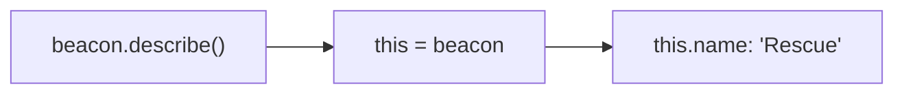

# Objects: bundling related values

A crew member has a name, a rank, a mission count and more. Keeping those in separate variables gets messy fast. An **object** bundles related values under one name, as **properties** (key: value pairs).

## Object literals

```js
const probe = {
  target: "Europa",
  battery: 80,
  "launch site": "Ares Base",
};
```

## Reading and writing properties

| Way | Example | Use it when… |
| --- | --- | --- |
| Dot notation | `probe.target` | The name is a simple word |
| Bracket notation | `probe["launch site"]` | The name has spaces or symbols |
| Bracket with a variable | `probe[key]` | The name is stored in a variable |

```js
probe.battery -= 10;          // change a property
probe.status = "active";      // add a new one at any time
console.log(probe.altitude);  // undefined: no such property
```

Watch the difference: `probe[key]` uses the **value** of the variable `key`, while `probe.key` looks for a property literally called `"key"`.

## Methods and `this`

A function stored in an object is a **method**. Inside a method, **`this`** is the object the method was called on:

```js
const beacon = {
  name: "Rescue",
  frequency: 121,
  describe() {
    return `${this.name} on ${this.frequency} MHz`;
  },
};

console.log(beacon.describe());   // "Rescue on 121 MHz"
```

Write methods with the `describe() { ... }` shorthand. **Arrow functions don't get their own `this`**: they borrow it from the code around them, so `this` inside an arrow method is *not* the object.



## Looking at all the properties

```js
const fuel = { main: 40, reserve: 10 };

Object.keys(fuel);      // ["main", "reserve"]
Object.values(fuel);    // [40, 10]
Object.entries(fuel);   // [["main", 40], ["reserve", 10]]

for (const [tank, amount] of Object.entries(fuel)) {
  console.log(`${tank}: ${amount}`);
}
```

`const [tank, amount]` unpacks each `[name, value]` pair into two variables.

> **Pilot's tip:** `undefined` from an object usually means a misspelled property name, or dot notation used where you meant a variable.

---

### Before you move on

- [ ] I can create an object literal, and read, change and add properties
- [ ] I know when to use dot notation and when to use brackets
- [ ] I know `this` in a method is the object it was called on, and that arrow functions don't get their own `this`
- [ ] I can use `Object.keys`, `values` and `entries`
