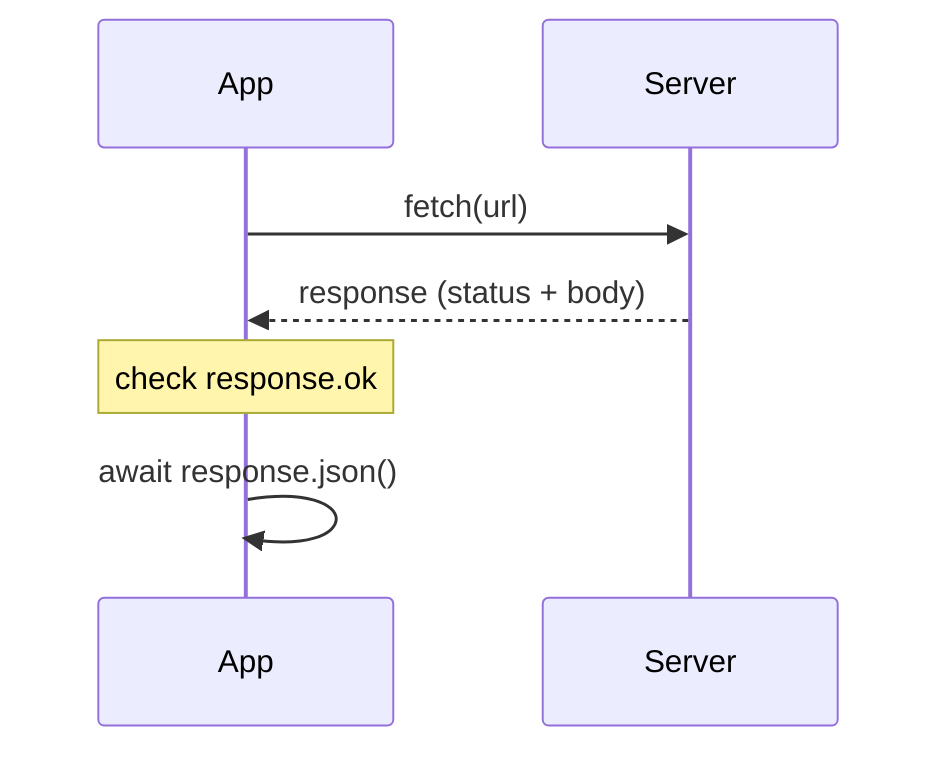

# Fetching data from a server

Most apps get their data from a server: star charts, weather, a leaderboard. In JavaScript, **`fetch`** sends a request over the network and gives back a **promise** of the response, so everything from Promise Protocol applies here.

## A request, step by step

```js
async function loadWeather(station) {
  const response = await fetch(`https://ops.example/weather/${station}`);

  if (!response.ok) {
    throw new Error(`Weather server said ${response.status}`);
  }

  const weather = await response.json();   // turn the JSON body into an object
  return weather.summary;
}
```

| Step | What it does |
| --- | --- |
| `await fetch(url)` | Sends the request and waits for the **response** to arrive |
| `response.status` | The HTTP status code: `200` OK, `404` not found, `500` server error… |
| `response.ok` | `true` for success codes (200–299), `false` otherwise |
| `await response.json()` | Reads the body and converts the JSON text into an object (this takes time too) |



## The big gotcha: `fetch` doesn't fail on 404

`fetch` only **rejects** when the request can't be made at all: no network, or a bad address. A `404` or `500` is still a **response**, so it doesn't throw. **Always check `response.ok`** yourself before using the body.

## Handling failure

```js
loadWeather("ares")
  .then((summary) => console.log(summary))
  .catch((error) => console.log(`No weather: ${error.message}`));
```

Network failures and your own thrown errors both end up in the same `catch`.

## Several requests at once: `Promise.all`

```js
const [weather, traffic] = await Promise.all([
  fetch("https://ops.example/weather").then((r) => r.json()),
  fetch("https://ops.example/traffic").then((r) => r.json()),
]);
```

`Promise.all` starts every request at the same time and waits for **all** of them, giving back their results **in the same order**. If **any** of them fails, the whole thing fails, straight into your `catch`.

> **Pilot's tip:** when data from a server comes out `undefined`, the request probably failed with an error status that was never checked.

---

### Before you move on

- [ ] I can fetch a URL, check `response.ok`, and read the body with `response.json()`
- [ ] I know `fetch` doesn't reject on error statuses such as 404
- [ ] I can handle failures with `catch` (or `try` / `catch`)
- [ ] I know `Promise.all` runs requests together and fails if any of them fails
