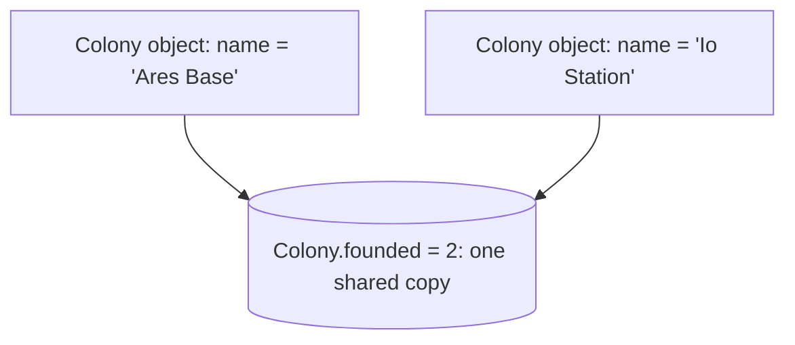

# Static: what belongs to the whole class

Everything on an object so far has belonged to **that one object**: each ship has its own name and fuel. Some things belong to the **class as a whole**: how many ships have been built, or a constant such as the speed of light. Those are marked `static`.

## Instance vs static

| | Instance (normal) | `static` |
| --- | --- | --- |
| How many copies | One **per object** | **One**, on the class itself |
| Reached through | An object: `ship.name` | The class name: `Ship.count` |
| On the objects? | Yes | **No**: `ship.count` is `undefined` |

```js
class Colony {
  static founded = 0;   // one shared count

  constructor(name) {
    this.name = name;   // each colony has its own
    Colony.founded++;   // every new colony adds to the same count
  }

  static describeAll() {
    return `${Colony.founded} colonies founded`;
  }
}

new Colony("Ares Base");
new Colony("Io Station");
console.log(Colony.founded);         // 2
console.log(Colony.describeAll());   // "2 colonies founded"
```



## Static methods and tool classes

A static method is called on the class, so no object is needed. A class with only static members is a handy toolbox:

```js
class Units {
  static KM_PER_MILE = 1.609;

  static milesToKm(miles) {
    return miles * Units.KM_PER_MILE;
  }
}

Units.milesToKm(100);   // 160.9
```

JavaScript's built-in **`Math`** works the same way: you never write `new Math()`.

| Call | Gives |
| --- | --- |
| `Math.max(4, 9)` / `Math.min(4, 9)` | `9` / `4` |
| `Math.round(4.5)` | `5`: to the nearest whole number |
| `Math.floor(4.9)` / `Math.ceil(4.1)` | `4` / `5`: always down / always up |
| `Math.abs(-7)` | `7` |
| `Math.random()` | A random number from 0 up to (not including) 1 |

> **Pilot's tip:** ask whether a value should be "one each" or "one for everyone". Making a per-object value `static` makes every object share it, so they all show the same number.

---

### Before you move on

- [ ] I know a static member has one copy on the class and is reached through the class name
- [ ] I know static members don't appear on the objects
- [ ] I can call static methods, and the `Math` ones, without creating an object
