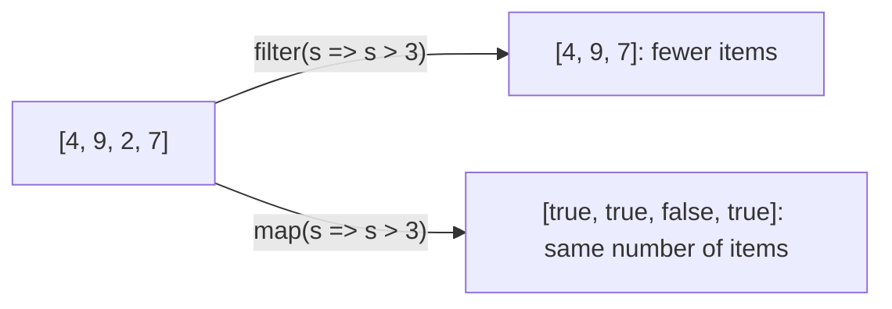

# Array methods: asking questions of a whole list

"Which ships are low on fuel?", "What's the total cargo?", "Sort the crew by rank." With plain loops, each question takes a few lines of setup. JavaScript arrays have **methods that take a function** (a *callback*) and run it on every item, so each question becomes one readable line.

## The core methods

| Method | Your function returns… | The method gives back |
| --- | --- | --- |
| `filter(fn)` | `true` to keep the item | A **new array** of the kept items |
| `map(fn)` | the new value for the item | A **new array**, the same length, of the new values |
| `find(fn)` | `true` for a match | The **first** matching item (or `undefined`) |
| `some(fn)` / `every(fn)` | `true` / `false` | Does **any** / **every** item match? |
| `forEach(fn)` | nothing | Nothing: it just runs your function on each item |
| `reduce(fn, start)` | the running total so far | One combined value |

```js
const speeds = [4, 9, 2, 7];

speeds.filter((s) => s > 3);            // [4, 9, 7]
speeds.map((s) => s * 10);              // [40, 90, 20, 70]
speeds.find((s) => s > 5);              // 9
speeds.some((s) => s > 8);              // true
speeds.reduce((total, s) => total + s, 0);  // 22
```

`filter`, `map`, `find` and `reduce` **don't change the original array**: they give you a new result.

## `filter` vs `map`



## Chaining

Each method returns an array, so you can chain them:

```js
const pilots = [
  { name: "Ari", hours: 120 },
  { name: "Bo", hours: 30 },
];

const veterans = pilots
  .filter((p) => p.hours >= 100)
  .map((p) => p.name);       // ["Ari"]
```

## Sorting: the one that changes the array

`sort()` rearranges the array **in place**, and **by default compares items as text**, which goes wrong for numbers (`"10"` comes before `"9"`). For numbers, give it a compare function:

```js
const fuel = [30, 5, 100];
const lowFirst = [...fuel].sort((a, b) => a - b);   // [5, 30, 100]
const highFirst = [...fuel].sort((a, b) => b - a);  // [100, 30, 5]
```

`[...fuel]` copies the array first, so the original keeps its order.

> **Pilot's tip:** if the answer has the wrong number of items, check whether you meant `filter` (keep some) or `map` (change all).

---

### Before you move on

- [ ] I know what `filter`, `map`, `find`, `forEach` and `reduce` each give back
- [ ] I know these methods leave the original array unchanged
- [ ] I can chain `filter` and `map`
- [ ] I know `sort()` needs a compare function for numbers, and changes the array
