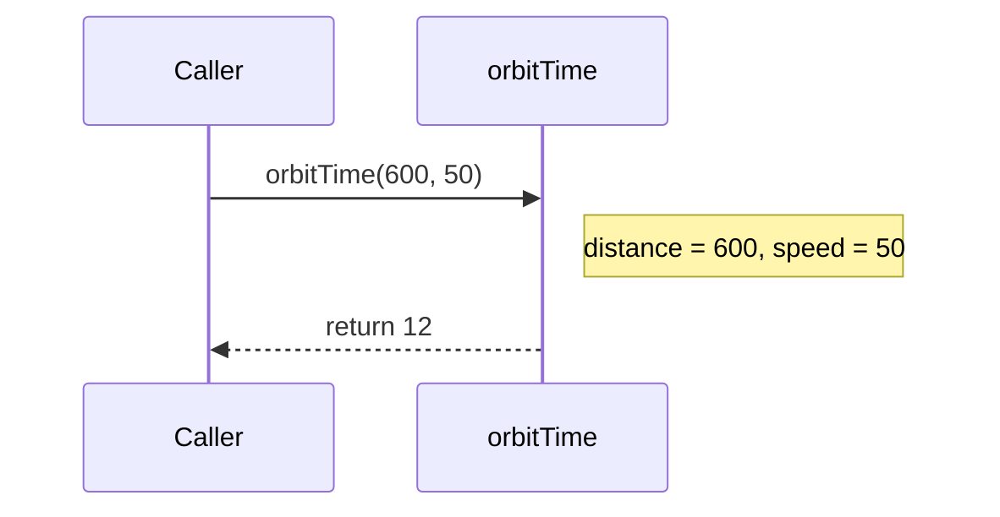

# Functions: naming a job so you can reuse it

A **function** is a named block of code that does one job. You write it once and **call** it whenever you need that job done, instead of copying the same lines around.

## Anatomy of a function

```js
function orbitTime(distance, speed) {
  return distance / speed;
}
```

| Part | Meaning |
| --- | --- |
| `orbitTime` | The function's name |
| `(distance, speed)` | **Parameters**: values the function needs |
| `{ ... }` | The body: what it does |
| `return` | Hands a value back to whoever called it, and ends the function |

## Calling a function

```js
const hours = orbitTime(600, 50);
console.log(hours);   // 12
```

The values in the call, `600` and `50`, are **arguments**. They fill the parameters in order. The value that comes back is stored in `hours`.



## Functions without `return`

A function that just **does** something (such as logging) doesn't need a `return`. But if you use its result anyway, you get **`undefined`**:

```js
function announce(message) {
  console.log(`*** ${message} ***`);
}

const result = announce("Docking complete");   // logs the message
console.log(result);                           // undefined
```

So if a function works something out, it must `return` it, or the caller gets `undefined`.

## Missing and extra arguments

JavaScript doesn't check how many arguments you pass. A missing one is `undefined`, and extra ones are ignored:

```js
orbitTime(600);        // speed is undefined, so this gives NaN
```

## Functions calling functions

A function can call other functions. When the inner one finishes, the program carries on **exactly where it left off**.

> **Pilot's tip:** if a function's result comes out as `undefined`, check that it actually `return`s the value it worked out.

---

### Before you move on

- [ ] I can point out the name, parameters, body and `return` of a function
- [ ] I know arguments fill the parameters in order
- [ ] I know a function with no `return` gives back `undefined`
- [ ] I know a missing argument is `undefined`
