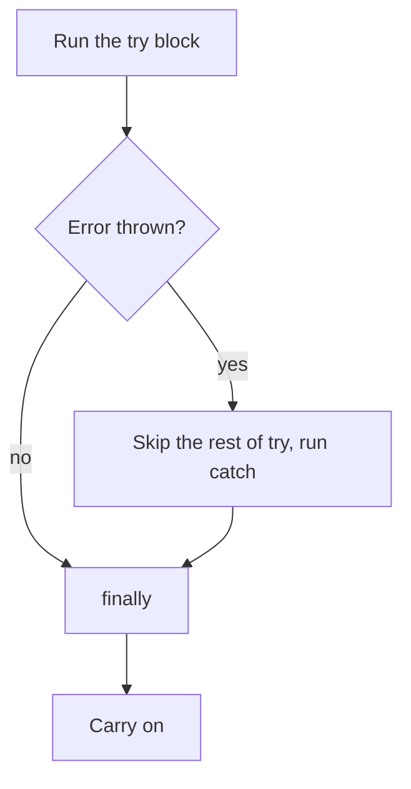

# Errors: when things go wrong

Some problems only show up while a program is running: reading a property of `null`, calling something that isn't a function, getting bad input. JavaScript **throws an error**. If nothing **catches** it, the script stops.

## Common errors

| Error | Typical cause |
| --- | --- |
| `TypeError` | Using `null` / `undefined` as an object, or calling something that isn't a function |
| `ReferenceError` | Using a variable that doesn't exist |
| `SyntaxError` | Code that isn't valid JavaScript (found before anything runs) |
| `RangeError` | A value outside what's allowed |

## `try`, `catch`, `finally`

```js
try {
  const crew = loadManifest();   // might throw
  console.log(crew.length);
} catch (error) {
  console.log(`Manifest problem: ${error.message}`);
} finally {
  console.log("Manifest check done");
}
```



- The moment something throws, the rest of the `try` is **skipped**.
- `catch (error)` receives the error. `error.message` describes it, and `error.name` is its type.
- `finally` runs **every time**, error or not.

## Throwing your own

```js
function setSpeed(speed) {
  if (speed > 9) {
    throw new Error("Warp 9 is the limit");
  }
  // ...
}
```

## Avoiding the crash: `?.` and `??`

Many errors come from reaching into something that isn't there. **Optional chaining** `?.` stops and gives `undefined` instead of throwing:

```js
const ship = { engine: null };

// ship.engine.power      → TypeError: cannot read properties of null
ship.engine?.power;       // undefined, no crash
ship.cargo?.manifest;     // undefined (cargo doesn't exist)
ship.engine?.power ?? 0;  // 0: ?? supplies a fallback for null/undefined
```

> **Pilot's tip:** an empty `catch { }` hides problems instead of handling them. If you catch an error, **do something** with it: report it, log it, or fall back to a value you've thought about.

---

### Before you move on

- [ ] I know an uncaught error stops the script
- [ ] I can trace which blocks run in a `try` / `catch` / `finally`
- [ ] I can throw my own `Error` and read `error.message`
- [ ] I can use `?.` and `??` to deal with missing values
