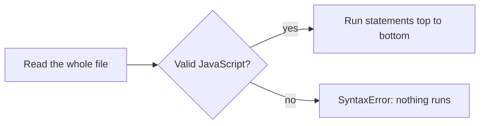

# Hello console: how a JavaScript program runs

JavaScript runs in every web browser, and on servers through Node.js. Wherever it runs, a program is a list of **statements**: instructions that run **one at a time, from top to bottom**.

## Talking back: `console.log`

`console.log(...)` prints whatever you give it to the console, the text panel where a program reports back. It's how you'll see what code is doing in every quest.

```js
console.log("Beacon online");
console.log(6 * 7);
console.log("Fuel:", 75, "units");
```

| Line | Shows |
| --- | --- |
| `console.log("Beacon online")` | `Beacon online`: text goes in quotes |
| `console.log(6 * 7)` | `42`: without quotes, it's **worked out** first |
| `console.log("Fuel:", 75, "units")` | `Fuel: 75 units`: several values are joined with spaces |

Quotes make all the difference. `console.log(6 * 7)` shows `42`, but `console.log("6 * 7")` shows the text `6 * 7`, because anything in quotes is just text. Text without quotes is read as code, so a missing pair of quotes is one of the most common beginner errors.

## Statements and semicolons

A **semicolon** `;` marks the end of a statement, like a full stop:

```js
console.log("Engines warming"); console.log("Engines ready");
```

Two statements can share a line when they're separated by a semicolon. If you leave a semicolon off at the end of a line, JavaScript usually adds one for you (this is called *automatic semicolon insertion*), but writing them yourself avoids surprises.

## Comments

Comments are notes for people. JavaScript skips them completely:

```js
// A single-line comment

/* A block comment
   can cover several lines */
```

Programmers also "comment out" code to switch it off for a while without deleting it.

## When code can't be read: syntax errors

Before running anything, JavaScript reads the whole file. If part of it isn't valid JavaScript (a missing bracket, or text without quotes), it reports a **SyntaxError** and **nothing runs at all**, not even the lines before the mistake.



> **Pilot's tip:** JavaScript is **case-sensitive**: `console.log` works, `Console.Log` doesn't.

---

### Before you move on

- [ ] I know statements run top to bottom
- [ ] I know `console.log` can show text, results and several values at once
- [ ] I know quotes make text, and unquoted words are read as code
- [ ] I know comments are skipped and a syntax error stops the whole file
