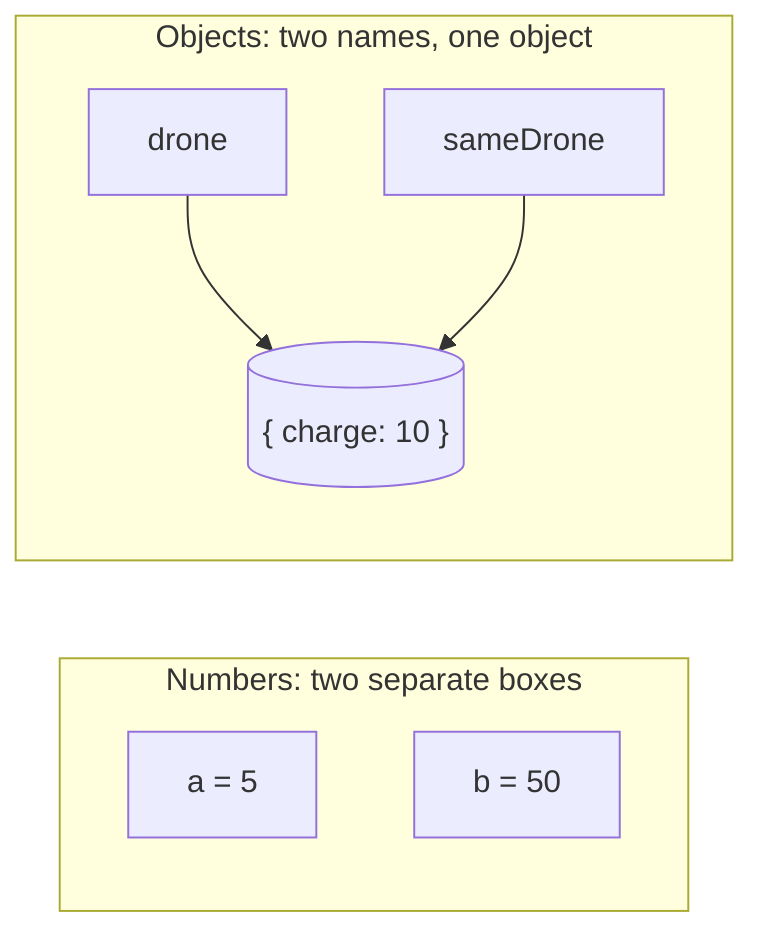

# References and copies

Sometimes copying a variable gives you an independent copy, and sometimes it gives you **a second name for the same thing**. Knowing which is which prevents some of the most confusing bugs in JavaScript.

## Simple values are copied

Numbers, strings and booleans are **copied** when you assign them:

```js
let a = 5;
let b = a;     // b gets its own 5
b = 50;        // a is still 5
```

## Objects and arrays are shared

An object (and an array, which is a kind of object) lives in one place, and a variable holds a **reference** to it. Assigning copies the **reference**, so both names point at **the same object**:

```js
const drone = { charge: 90 };
const sameDrone = drone;     // not a copy!
sameDrone.charge = 10;
console.log(drone.charge);   // 10
```



The same happens when you pass an object to a function: the function gets a reference to **your** object, so changes it makes are seen outside.

## `===` on objects

`===` on objects checks whether they're **the same object**, not whether they look alike:

```js
const x = { id: 1 };
const y = x;
const z = { id: 1 };

x === y;   // true: the same object
x === z;   // false: same contents, different objects
```

## Making real copies

| Copy | How | Nested objects and arrays inside? |
| --- | --- | --- |
| **Shallow** | `{ ...obj }`, `[...arr]` | **Still shared** with the original |
| **Deep** | `structuredClone(obj)` | Copied too: completely independent |

```js
const ship = { name: "Ark", crew: ["Ari"] };

const shallow = { ...ship };
shallow.name = "Copy";        // fine: ship.name is still "Ark"
shallow.crew.push("Bo");      // ship.crew changes too: the array is shared

const deep = structuredClone(ship);
deep.crew.push("Cy");         // only deep changes
```

> **Pilot's tip:** if changing one thing unexpectedly changes another, they're almost certainly sharing a reference. Make a copy before changing it.

---

### Before you move on

- [ ] I know simple values are copied, but objects and arrays are shared by reference
- [ ] I know `===` on objects means "the same object"
- [ ] I can make a shallow copy with spread, and a deep copy with `structuredClone`
- [ ] I know a function can change an object that's passed to it
