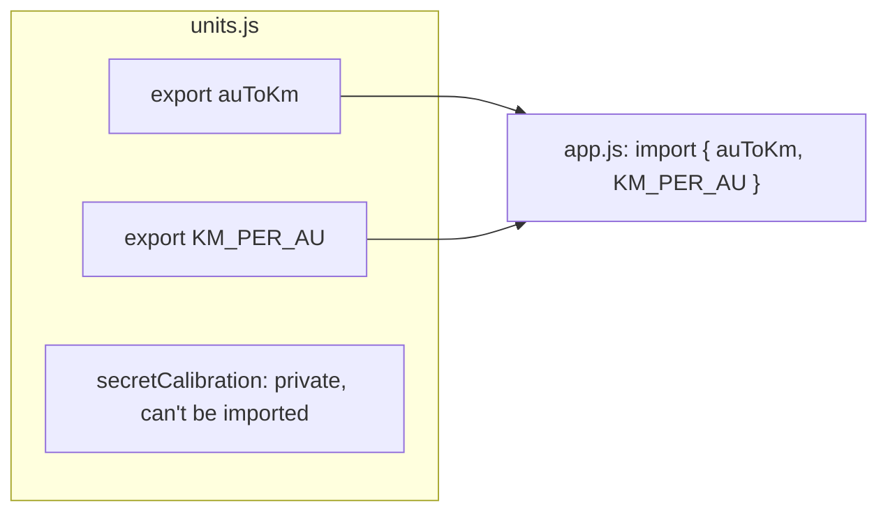

# Script communication 2: modules

As a program grows, one giant file becomes impossible to work in. **Modules** split a program into files. Each file is its own module: by default **everything in it is private**, and it only shares what it **exports**. Other files **import** what they need.

## Named exports

```js
// units.js
export const KM_PER_AU = 149597870.7;

export function auToKm(au) {
  return au * KM_PER_AU;
}

const secretCalibration = 0.9998;   // not exported: private to units.js
```

```js
// app.js
import { auToKm, KM_PER_AU } from "./units.js";

console.log(auToKm(2));
```

Named imports go **in braces**, using the **exact exported names**. `"./units.js"` is the path to the file, relative to this one.

## The default export

A module can also have **one** default export, its "main thing". It's imported **without braces**, under any name you like:

```js
// launch.js
export default function launch(ship) {
  return `${ship} launched`;
}
```

```js
// app.js
import launchShip from "./launch.js";       // any name works for a default
import launchShip, { auToKm } from "./both.js";   // default and named together
```

## Renaming and importing everything

```js
import { auToKm as toKm } from "./units.js";   // rename on import
import * as units from "./units.js";           // everything, as one object
units.auToKm(1);
```



## Modules run once

However many files import a module, it **runs only once**, and they all share the same copy of its variables. A module can keep private state, such as a counter, and expose functions that change it.

If you import a name the module doesn't export, the import fails before any code runs.

> **Pilot's tip:** "does not provide an export named …" means the name isn't exported, is spelled differently, or is a default export being imported with braces.

---

### Before you move on

- [ ] I know a module's code is private unless it's exported
- [ ] I can import named exports in braces, and a default export without them
- [ ] I can rename with `as`, and import everything with `* as`
- [ ] I know a module runs once and its state is shared by every importer
