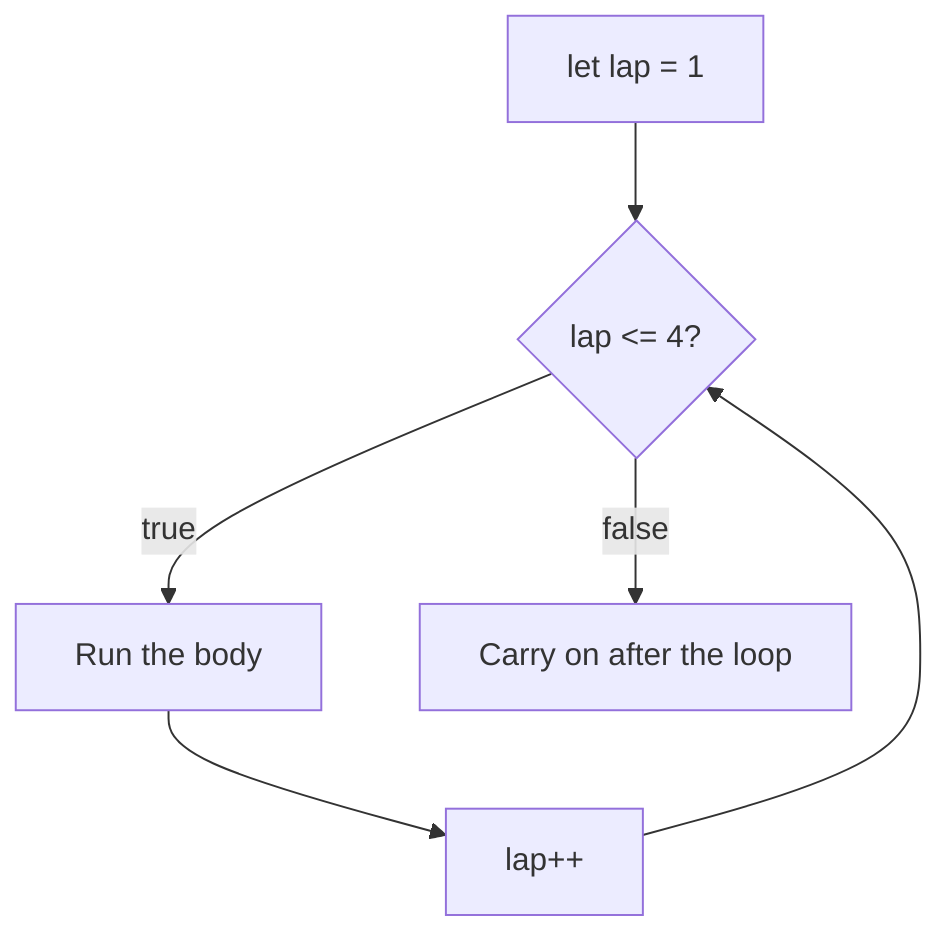

# Loops: doing it again (and again)

Checking ten sensors shouldn't take ten copies of the same code. A **loop** repeats a block for as long as you need.

## The `for` loop: when you know how many times

```js
for (let lap = 1; lap <= 4; lap++) {
  console.log(`Lap ${lap}`);
}
```

| Part | Example | When it runs |
| --- | --- | --- |
| Start | `let lap = 1` | Once, at the beginning |
| Condition | `lap <= 4` | Before **every** pass; false means stop |
| Step | `lap++` | After every pass |



This logs `Lap 1` to `Lap 4`. If the step moves the counter the **wrong way**, the condition never becomes false and the loop never ends.

## The `while` loop: until something changes

```js
let shields = 40;
while (shields < 100) {
  shields += 25;
}
// shields is now 115
```

Something inside a `while` loop **must** eventually make the condition false.

## A sneak peek: arrays and `for...of`

You'll study arrays properly in Cargo Train, but loops and arrays go together:

```js
const decks = ["Bridge", "Engine room", "Cargo"];

console.log(decks[0]);        // "Bridge": positions start at 0
console.log(decks.length);    // 3

for (const deck of decks) {   // visits each value in turn
  console.log(`Scanning ${deck}`);
}
```

`for...of` gives you each **value** directly, with no counter to get wrong.

## `break` and `continue`

| Keyword | What it does |
| --- | --- |
| `break` | Leaves the loop **immediately** |
| `continue` | Skips the rest of **this** pass and moves on to the next |

```js
for (let deck = 1; deck <= 5; deck++) {
  if (deck === 2) continue;   // skip deck 2
  if (deck === 4) break;      // stop completely at deck 4
  console.log(deck);          // logs 1 and 3
}
```

> **Pilot's tip:** to find out how many times a loop runs, trace its counter through every pass until the condition fails.

---

### Before you move on

- [ ] I can name the three parts of a `for` loop and when each one runs
- [ ] I know a loop needs a condition that eventually becomes false
- [ ] I can use `for...of` to visit each value in an array
- [ ] I know what `break` and `continue` do
