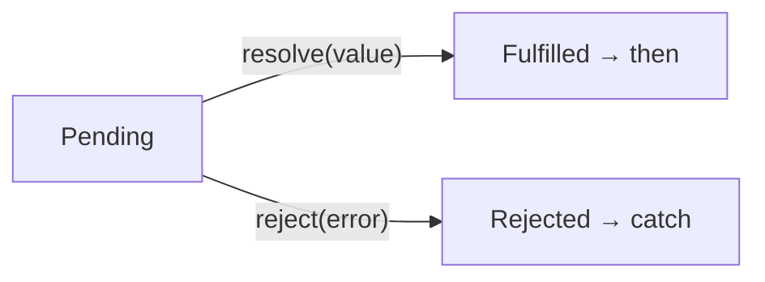

# Promises and async/await

Callbacks work for things that take time, but chains of them quickly nest into a tangle. A **promise** is an object standing in for a value that will arrive **later**, and `async` / `await` let you write code that waits for it while still reading top to bottom.

## Promises

A promise is in one of three states: **pending**, then either **fulfilled** (with a value) or **rejected** (with an error).

```js
function scanPlanet(name) {
  return new Promise((resolve, reject) => {
    if (!name) {
      reject(new Error("No planet given"));   // fail
      return;
    }
    setTimeout(() => resolve(`${name}: 3 moons`), 500);   // succeed later
  });
}

scanPlanet("Tethys")
  .then((result) => console.log(result))           // runs on success
  .catch((error) => console.log(error.message))    // runs on failure
  .finally(() => console.log("Scan finished"));    // runs either way
```



`then` and `catch` callbacks never run immediately: like timers, they wait until the current code has finished. A promise that's already settled is handled **before** any timers that are still waiting.

## `async` and `await`

An `async` function can use `await`, which **pauses that function** until a promise settles, then gives you its value:

```js
const wait = (ms) => new Promise((resolve) => setTimeout(resolve, ms));

async function dock() {
  console.log("Approaching");
  await wait(300);              // pause dock() here, not the whole program
  console.log("Docked");
  return "Clamps locked";
}

dock().then((status) => console.log(status));
console.log("Meanwhile...");
// Approaching, Meanwhile..., Docked, Clamps locked
```

- An `async` function runs normally until its first `await`. Then the rest of the program carries on.
- An `async` function **always returns a promise**, even when you `return` a plain value.
- **Forget the `await`** and you get the promise itself, not its value. Comparing or printing it gives nonsense (`[object Promise]`).

## Errors with `await`: `try` / `catch`

```js
async function safeScan() {
  try {
    const result = await scanPlanet("");
    console.log(result);
  } catch (error) {
    console.log(`Scan failed: ${error.message}`);
  }
}
```

> **Pilot's tip:** if a value from an `async` function prints as `[object Promise]`, an `await` is missing.

---

### Before you move on

- [ ] I know a promise stands for a value that arrives later, and its three states
- [ ] I can handle a promise with `then`, `catch` and `finally`
- [ ] I know `await` pauses only its `async` function, and an `async` function returns a promise
- [ ] I can catch a failed `await` with `try` / `catch`, and spot a missing `await`
