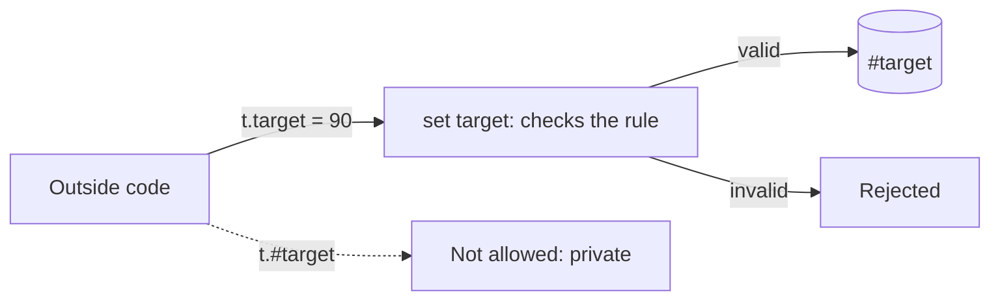

# Pillar 1: Encapsulation

So far, any code can reach into an object and set `reactor.temperature = -400`. **Encapsulation** means keeping an object's data **sealed inside it**, and only letting it change through doors the class controls. The object protects its own rules.

## The four pillars of OOP

This is the first of the four big ideas you'll learn in the next quests:

| Pillar | In one line |
| --- | --- |
| **Encapsulation** | Hide the data; control how it changes |
| Inheritance | Build new classes on top of existing ones |
| Polymorphism | One call, different behaviour per object |
| Abstraction | Describe *what* must be done, not *how* |

## Private fields: `#`

A field whose name starts with `#` is **private**: only code inside the class can touch it.

```js
class Engine {
  #temperature = 20;

  heatUp() {
    this.#temperature += 100;   // fine: inside the class
  }
}

const e = new Engine();
// e.#temperature = 9000;       // SyntaxError: private to Engine
```

## Getters and setters: controlled doors

A **getter** (`get`) and **setter** (`set`) look like an ordinary property from outside, but run code when the property is read or changed:

```js
class Thermostat {
  #target = 20;

  get target() {
    return this.#target;
  }

  set target(value) {
    if (value < 5 || value > 30) {
      console.log("Rejected: out of range");
      return;
    }
    this.#target = value;
  }
}

const t = new Thermostat();
t.target = 25;      // the setter runs: accepted
t.target = 90;      // the setter runs: rejected
console.log(t.target);   // 25
```



A getter **without** a setter makes a read-only property. Assigning to it is ignored, or throws in strict mode (which classes and modules always use).

## Methods as the only way in

Often the best door isn't a setter but a method that describes the action: `deposit(amount)`, `takeDamage(amount)`. The class decides what's allowed.

> **Pilot's tip:** a rule is only as strong as its weakest door. If any method inside the class writes the `#` field directly, it skips the checks in the setter.

---

### Before you move on

- [ ] I can explain encapsulation in one sentence
- [ ] I know a `#` field is private to its class
- [ ] I can read a getter and a setter, and know a getter on its own is read-only
- [ ] I know why every change should go through the class's own checks
