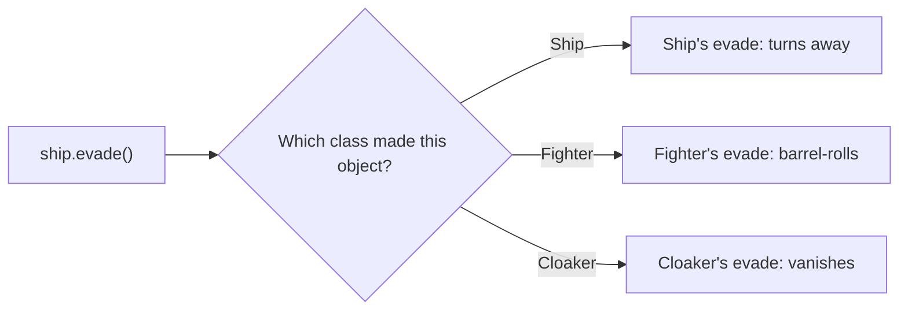

# Pillar 3: Polymorphism

Polymorphism means "many forms". You call **one method**, and each object responds **in its own way**. The commander orders "evade", and the fighter barrel-rolls, the freighter turns slowly and the cloaker vanishes, all from the same call.

## Overriding methods

A child class **overrides** a parent's method by defining one with **exactly the same name**:

```js
class Ship {
  evade() {
    return "turns away";
  }
}

class Fighter extends Ship {
  evade() {
    return "barrel-rolls";
  }
}

class Cloaker extends Ship {
  evade() {
    return "vanishes from sensors";
  }
}
```

## The object decides

When `ship.evade()` runs, JavaScript looks for `evade` on the object's **own class first**, then on its parent, and so on up the chain:

```js
for (const ship of [new Ship(), new Fighter(), new Cloaker()]) {
  console.log(ship.evade());
}
// turns away
// barrel-rolls
// vanishes from sensors
```



Code that loops over ships **never needs changing** when a new kind of ship is added: give the new class its own `evade` and the loop just works.

A method with a slightly **different** name (a typo) doesn't override anything. It just becomes a separate method, and the parent's version keeps running.

## Building on the original: `super.method()`

```js
class Tanker extends Ship {
  evade() {
    return `dumps fuel and ${super.evade()}`;   // "dumps fuel and turns away"
  }
}
```

## Duck typing

JavaScript doesn't check what class an object came from before calling a method. It only checks that the method **exists**. "If it walks like a duck and quacks like a duck…":

```js
const decoy = { evade() { return "pops a flare"; } };   // no class at all
```

A plain object with an `evade` method works in the same loop as the ships. That's polymorphism without inheritance.

---

### Before you move on

- [ ] I know a child overrides a method by defining one with exactly the same name
- [ ] I know the object's own class decides which version runs
- [ ] I can use `super.method()` to build on the parent's version
- [ ] I can explain duck typing
