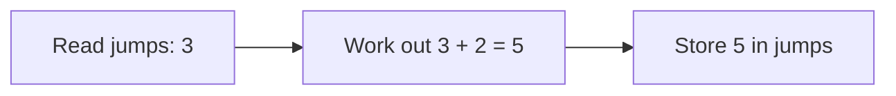

# Variables: naming the values you keep

A program needs to remember things: the fuel level, the pilot's name, how many jumps are left. A **variable** is a name that holds a value, so you can use it, and change it, later.

## Declaring variables: `let` and `const`

```js
let shields = 40;
const callsign = "Vega";
```

| Keyword | Meaning | Use it for |
| --- | --- | --- |
| `let` | The value **can be changed** later | Things that change: fuel, scores, counters |
| `const` | The name can **never be pointed at a new value** | Things that stay put: names, settings |

```js
shields = 75;        // fine: let can change
// callsign = "Ari"; // TypeError: const can't be reassigned
```

Start with `const`, and switch to `let` only when the value really needs to change. You may also see `var` in older code. It's the old way, with confusing rules, so avoid it.

## `=` stores a value, and replaces the old one

`=` means **"store the value on the right in the variable on the left"**. Whatever was there before is gone:

```js
let jumps = 3;
jumps = 5;          // jumps is now 5; the 3 is gone
```

To build on the old value, read it first:

```js
let jumps = 3;
jumps = jumps + 2;  // works out 3 + 2, then stores 5
```



The right-hand side is always worked out **completely** before anything is stored, which is why a variable can appear on both sides.

## Naming rules

- Names can use letters, digits, `_` and `$`, but can't start with a digit.
- By convention, names use **camelCase**: `fuelLevel`, `maxJumps`.
- Names are case-sensitive: `fuel` and `Fuel` are different variables.

> **Pilot's tip:** if a value "won't change", follow it line by line and check where (and whether) a new value is stored.

---

### Before you move on

- [ ] I can declare variables with `let` and `const`, and know which one can change
- [ ] I know `=` replaces the old value
- [ ] I know the right-hand side is worked out before it's stored
