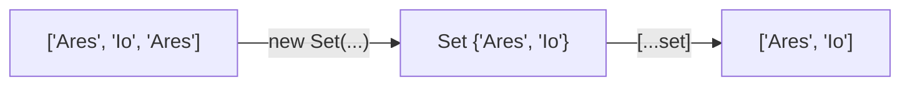

# Map and Set: looking things up, and keeping things unique

Arrays are great for ordered lists, but finding one item means searching through them. JavaScript has two more collections built for other jobs: **`Map`** looks a value up by its key, and **`Set`** keeps only one of each value.

## Map: key → value

```js
const gravity = new Map();
gravity.set("Earth", 9.8);
gravity.set("Mars", 3.7);
gravity.set("Mars", 3.72);   // the same key again replaces the value

console.log(gravity.get("Mars"));     // 3.72
console.log(gravity.has("Pluto"));    // false
console.log(gravity.get("Pluto"));    // undefined
console.log(gravity.size);            // 2
gravity.delete("Earth");
```

| Method | What it does |
| --- | --- |
| `map.set(key, value)` | Adds the pair, or **replaces** the value if the key exists |
| `map.get(key)` | The value, or `undefined` if the key isn't there |
| `map.has(key)` | `true` or `false` |
| `map.delete(key)` | Removes the pair |
| `map.size` | How many pairs there are |

**A Map's entries are read with `get`**, not with square brackets. `gravity["Mars"]` looks for an ordinary property on the Map object itself, and gives `undefined`.

## Looping over a Map

A Map remembers the order its keys were added. Each entry is a `[key, value]` pair, which you can unpack straight into two variables:

```js
for (const [planet, g] of gravity) {
  console.log(`${planet}: ${g}`);
}
```

## Counting with a Map

```js
const counts = new Map();
for (const word of ["go", "stop", "go"]) {
  counts.set(word, (counts.get(word) ?? 0) + 1);
}
// "go" → 2, "stop" → 1
```

`a ?? b` means "use `a`, unless it's `null` or `undefined`, then use `b`". Here it turns a missing count into `0`.

## Set: one of each

A `Set` holds values with **no duplicates**:

```js
const visited = new Set(["Ares", "Io", "Ares"]);
console.log(visited.size);          // 2
console.log(visited.has("Io"));     // true
visited.add("Titan");

const list = [...visited];          // back to an array: ["Ares", "Io", "Titan"]
```

`[...visited]` *spreads* the Set's values into a new array (you'll see `...` again in Unpacking Bay).



---

### Before you move on

- [ ] I can `set`, `get`, `has` and `delete` entries in a Map
- [ ] I know setting an existing key replaces its value
- [ ] I know Map entries are read with `get`, not square brackets
- [ ] I can use a Set to remove duplicates, and `??` to supply a default
