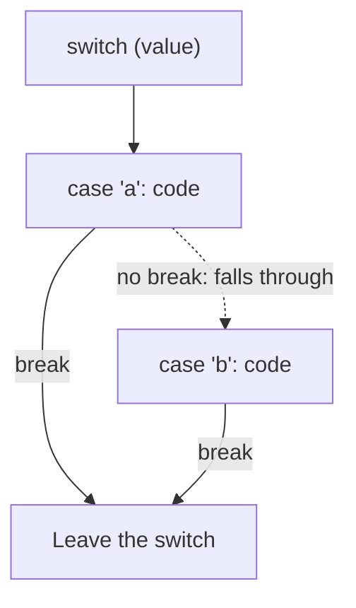

# Switch: choosing between many options

When one value could be any of several options, a long `if` / `else if` chain gets hard to read. A `switch` lays the choices out like a table.

## How a switch works

```js
const planetType = "gas";

switch (planetType) {
  case "rocky":
    console.log("Prepare landing gear");
    break;
  case "gas":
  case "ice":
    console.log("Stay in orbit");
    break;
  default:
    console.log("Unknown world: scan first");
}
```

| Piece | Meaning |
| --- | --- |
| `switch (planetType)` | The value being checked |
| `case "rocky":` | Where to start when the value matches |
| Stacked cases | `case "gas":` directly above `case "ice":` means **either** value runs the same code |
| `break;` | Stop here and leave the switch |
| `default:` | Runs when nothing matched, like a final `else` |

## Strict matching

`switch` compares with **`===`**, so the type must match as well as the value. `case 1:` does **not** match the string `"1"`.

## Fall-through: why `break` matters

A `case` is only a **starting point**. Without a `break`, JavaScript carries on running the code of the **next** cases too. This is called *falling through*:



Falling through on purpose is how stacked cases work (an empty case falls into the next one). Falling through by accident is a classic bug.

## Returning from a switch

Inside a function, a case can `return` straight away. Leaving the function leaves the switch too, so no `break` is needed:

```js
function dockingFee(size) {
  switch (size) {
    case "small":
      return 10;
    case "large":
      return 50;
    default:
      return 25;
  }
}
```

> **Pilot's tip:** if a switch seems to pick two branches, look for a case that's missing its `break`.

---

### Before you move on

- [ ] I can read `case`, `break` and `default`
- [ ] I know stacked cases share one block of code
- [ ] I know switch compares strictly (`===`)
- [ ] I know what happens when a `break` is missing
