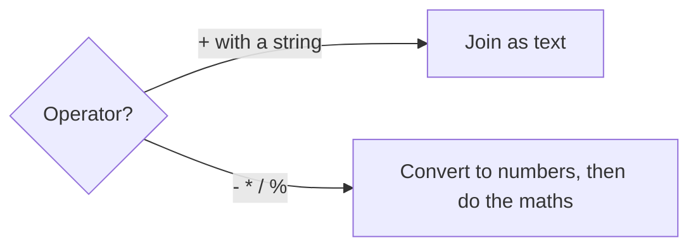

# Data types: what kind of value is this?

Every value in JavaScript has a **type**. Unlike some languages, you don't declare it: JavaScript works it out from the value, and it can change when a variable is given a new value. That flexibility is handy, but it's also where a lot of surprising bugs come from.

## The main types

| Type | Holds | Example |
| --- | --- | --- |
| `number` | Whole numbers **and** decimals: there's just one number type | `7`, `-40.5` |
| `string` | Text, in quotes | `"Kepler-9"`, `'Ares'` |
| `boolean` | `true` or `false` | `true` |
| `undefined` | "No value has been given yet" | a `let` with no value |
| `null` | "Deliberately empty" | `let target = null;` |

`typeof` tells you a value's type, as text:

```js
console.log(typeof 3.5);      // "number"
console.log(typeof "3.5");    // "string"
console.log(typeof false);    // "boolean"
```

Because there's only one number type, division keeps its decimals: `7 / 2` is `3.5`.

## `+` with a string means "join"

`+` adds two numbers, but as soon as **either side is a string**, it joins them as text:

```js
console.log(10 + 5);      // 15
console.log("10" + 5);    // "105"
```

## Type coercion: JavaScript converting for you

Most other operators only work on numbers, so JavaScript **quietly converts** strings into numbers for them:

```js
console.log("10" - 5);    // 5
console.log("10" * 2);    // 20
```



## Converting on purpose

Don't rely on automatic conversion: convert values yourself.

```js
const typed = "42";
const speed = Number(typed);       // 42, a number
const label = String(99);          // "99", a string

console.log(Number("lots"));       // NaN
```

**`NaN`** means "Not a Number". It's what you get when text can't be turned into a number. Confusingly, `typeof NaN` is still `"number"`.

> **Pilot's tip:** when numbers come out glued together (`"4025"` instead of `65`), one of them is a string.

---

### Before you move on

- [ ] I can name JavaScript's main types and check one with `typeof`
- [ ] I know `+` joins text when either side is a string
- [ ] I know `-`, `*` and `/` convert strings to numbers automatically
- [ ] I can convert with `Number()` and `String()`, and know what `NaN` means
