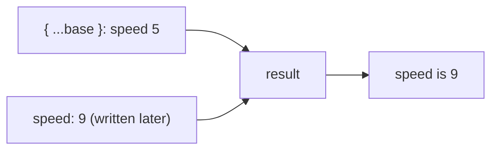

# Destructuring and spread: unpacking and repacking

Modern JavaScript has shorthand for pulling values **out** of objects and arrays (destructuring), and for pouring them **into** new ones (spread). You'll see it everywhere in real code.

## Object destructuring

Create variables straight from an object's properties, **by name**:

```js
const probe = { target: "Titan", battery: 60, sensors: { camera: true } };

const { target, battery } = probe;            // target = "Titan", battery = 60
const { battery: charge } = probe;            // rename: a variable called charge
const { sensors: { camera } } = probe;        // reach into a nested object
const { owner = "Fleet" } = probe;            // default when the property is missing
```

## Array destructuring

Arrays are unpacked **by position**:

```js
const [lead, wing] = ["Kestrel", "Osprey", "Heron"];   // lead = "Kestrel", wing = "Osprey"
const [first, ...others] = ["A", "B", "C"];            // others = ["B", "C"]
```

`...others` is a **rest** element: it collects everything left over into an array.

## Spread `...`: pouring values in

The same three dots, used on the other side, **spread** the values out:

```js
const day = ["Ari", "Bo"];
const night = ["Cy"];
const all = [...day, ...night, "Dee"];    // ["Ari", "Bo", "Cy", "Dee"]

const base = { speed: 5, armour: 2 };
const boosted = { ...base, speed: 9 };    // { speed: 9, armour: 2 }
```

When objects are spread together, **later properties win**:



So the order is how you choose which values take priority: defaults first, overrides after.

## Rest parameters

`...` in a function's parameters gathers any number of arguments into an array:

```js
function loudest(...volumes) {
  return Math.max(...volumes);   // spread the array back out as arguments
}

loudest(3, 9, 4);   // 9
```

> **Pilot's tip:** `...` on the left of `=` (or in parameters) **collects**; anywhere else it **spreads**.

---

### Before you move on

- [ ] I can destructure an object by name, including renaming, nesting and defaults
- [ ] I can destructure an array by position, with `...rest`
- [ ] I can combine arrays and objects with spread, and know later properties win
- [ ] I can write a function with rest parameters
